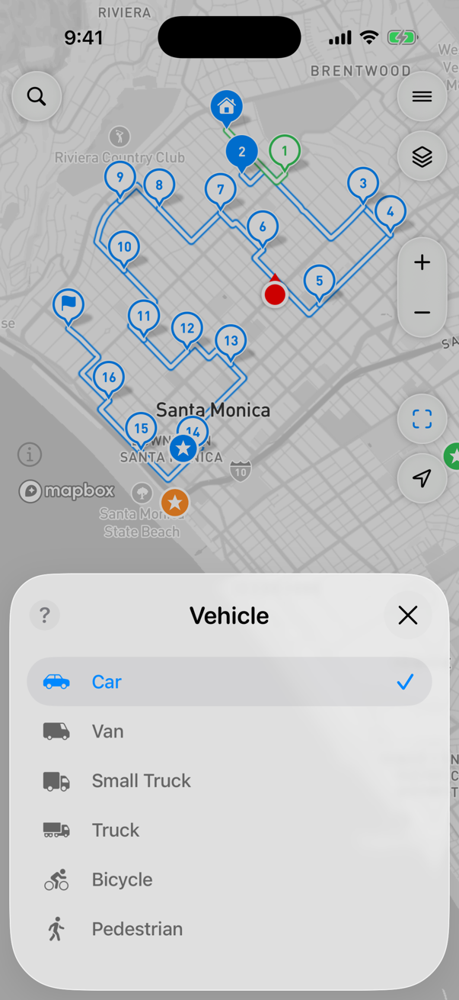

# Why do some of my stops have issues, "Route not found" or other errors


**Using MyWay on Android?** This page describes the iOS app version 3. See [Version 2 of this page](https://help.mywayroute.com/v2/faq/why-do-some-of-my-stops-have-issues-path-not-found-or-unexpected-error).


## **Stops with Issues**

MyWay recognizes problems with stops and marks them. A stop can have an issue for many reasons. The most common ones:

* The stop can't be reached by public road, because of your [vehicle type](why-do-some-of-my-stops-have-issues-path-not-found-or-unexpected-error.md#vehicle-type-issue) or because there is no road access at all.
* MyWay can't meet the stop's [time window](../guides/understanding-stop-settings.md#time-windows) because of a tight schedule or many stops with time windows.
* The stop is in a different country, on an island or in a forest.

MyWay shows these issues on the [Optimize Route screen](../guides/how-to-use-myway-route-planner.md#optimization-options-build-and-optimize-your-route): each version shows the number of issues, and MyWay warns you that "Some stops have issues and may be skipped". Stops MyWay can't fit into the route move to the "Skipped" section. Tap **Fix It** to go to the first stop with a problem.

Issues you can see on a stop:

* **"Route not found"**: there is no road to this stop for your vehicle.
* **"No route to this stop in the current order"**: the stop can't be reached in the order you set.
* **"Time window constraint could not be satisfied"**: MyWay can't arrive at the stop within its [time window](../guides/understanding-stop-settings.md#time-windows).
* **"Late arrival is expected at this stop"** or **"A long wait is expected at this stop"**: you'll arrive after the time window ends or long before it starts.
* **"Priority stop is not at the beginning"**: in your own (Current) order, a [priority](../guides/understanding-stop-settings.md#priority-asap-button) stop isn't at the start of the route.
* **"Pickup must come before its delivery"**: in your own order, a delivery comes before its [pickup](../guides/understanding-stop-settings.md#pickup-and-delivery).

MyWay also warns you about stops that look wrong: a stop far from the others, a stop with the same coordinates as another one, and a route that crosses a state line or a border. For what to do about each of these messages, see [Error messages](error-messages.md#issues-and-warnings-on-a-stop).

## **You reached the stops limit**

The number of stops in a route depends on your [vehicle type](../guides/understand-vehicle-settings.md#stop-limits): up to 200 for Car and Van, 150 for Small Truck and Truck, and 50 for Bicycle and Pedestrian. Completed and skipped stops count; the start and end locations don't. If your route has more, MyWay shows "Too many stops: this vehicle allows up to…". Remove some stops or split the route.

## **Route not found** 

**"Route not found"** means that one or more stops can't be reached by public road with your vehicle (they are on an island, in a forest, really far from other stops, etc.). Optimization algorithms can't resolve this automatically, so these stops need a manual check. To help you, the app marks the stops with known errors and leaves them out of the optimized stop sequence. In most cases, the cause is a [vehicle type issue](why-do-some-of-my-stops-have-issues-path-not-found-or-unexpected-error.md#vehicle-type-issue) or a [route planned far from your location](why-do-some-of-my-stops-have-issues-path-not-found-or-unexpected-error.md#route-far-from-your-location).


Sometimes the app can't show an error on a stop because there is no clear reason for it. In this case, check all stops manually and look for the ones that don't look right.


## **Route far from your location** 

Sometimes the route can't be built because the stops are too far from each other or from the start. This usually happens when you build a route outside your region, on another continent or across long distances. For example:

* You are planning a trip to Europe, and all your stops are there, but the start location is in the USA.
* Your stops are spread across all states in the USA, one stop in each state.
* Your stops are in one local area, but the end location is on an island with no road connection to that area.
* You are planning a trip to Europe with the start location and stops there, but when you reoptimize the route from home, MyWay uses your current location as the start.

**Solution:**

**If you build a route in a remote region,** [**turn off My Location**](../guides/using-the-map.md#your-location) **in the map layers and set a specific address as your start and end (not your current location).** If your stops are spread out, consider splitting one big route into several, for example one route each for North, South, West and East, or one route for each state or region. Don't hesitate to contact us if you need help with this.

**Explanation:**

When you build a route, the app builds a matrix of real road distances between every pair of stops. This matrix tells us the actual distances between stops, so we can find the most efficient route. In the cases above, the matrix can't be built. Other apps ignore this problem and use straight lines between stops, ignoring actual road connections. That over-the-air connection completely messes up route optimization, but it does let those apps look great on paper when you build your route.

## **Vehicle type issue** 

This can happen if your vehicle type is a big vehicle, like a truck (lorry). The issue appears when the optimization algorithm can't find any way for this type of vehicle to reach one or more stops (low bridges, narrow roads not suitable for a long or tall vehicle, etc.). It's easy to fix: change the vehicle type to **Car**. Don't worry, most vehicles do just fine on routes for a car or van. Only trucks that are long, tall or big will face issues, and they absolutely must use **Small Truck** or **Truck** as the vehicle type.

<figure><figcaption>
Vehicle type settings
</figcaption></figure>


[Vehicle Type](../guides/understand-vehicle-settings.md) and [route settings](../guides/how-to-use-myway-route-planner.md#route-settings) affect how the route looks, its time and distance, and how "correct" and convenient it is overall. [Make sure you use the right settings](the-route-myway-produced-doesnt-look-correct.md) to get the best results for your needs.


## **Other errors** 

If MyWay can't build the route at all, it shows a message like "Couldn't calculate the route. Try again.", "The route calculation is taking too long. Try again later." or an error code. Check your route and try again in a minute or so. If you see "Couldn't determine your current location", check that MyWay has access to your location, or turn off **My Location** in the map layers. If the problem persists, [share your route with us](../guides/export-your-route-and-share-it-with-others.md#share-route-copy) so we can help you [resolve the issue](../how-to-contact-us.md). All messages and what to do about them are listed in [Error messages](error-messages.md).
