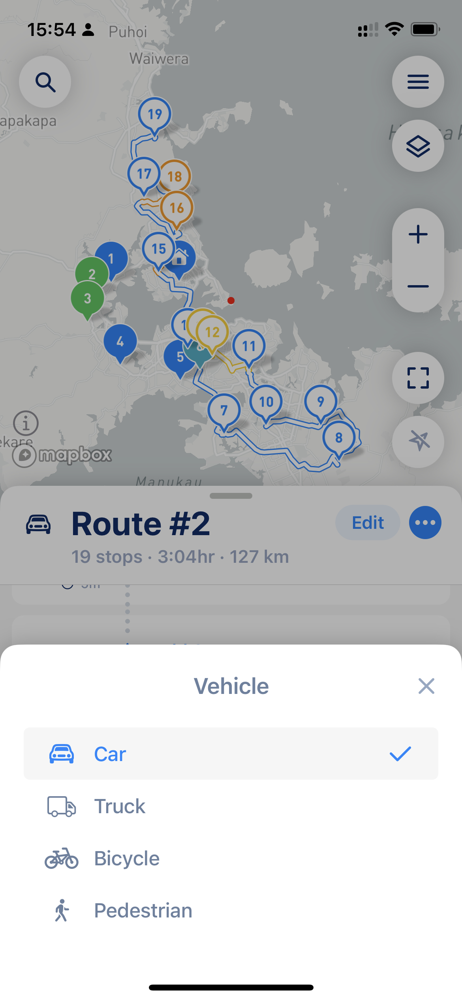

# Why do some of my stops have issues, "Route not found" or other errors


**Using MyWay on Android?** This page describes the iOS app version 3. See [Version 2 of this page](https://help.mywayroute.com/faq/why-do-some-of-my-stops-have-issues-path-not-found-or-unexpected-error).


## **Stops with Issues**

MyWay Route Planner has an intelligent system that recognizes issues related to stops and marks them. There are many reasons why a stop can have an issue. The most common are: the stop can't be reached by public road (because of the [vehicle type](why-do-some-of-my-stops-have-issues-path-not-found-or-unexpected-error.md#vehicle-type-issue), or simply no road access), no ability to satisfy the [time window](../guides/understanding-stop-settings.md#time-windows) of a stop (because of a tight schedule, or many stops with time windows), or the stop is in a different country, on an island, in a forest.

MyWay shows these issues on the [Optimize Route screen](../guides/how-to-use-myway-route-planner.md#optimization-options-build-and-optimize-your-route): each version shows the number of issues, and MyWay warns you that "Some stops have issues and may be skipped". Stops MyWay can't fit into the route move to the "Skipped" section. Tap "Fix It" to go to the first stop with a problem.

Issues you can see on a stop:

* **"Route not found"**: there is no road to this stop for your vehicle.
* **"No route to this stop in the current order"**: the stop can't be reached in the order you set.
* **"Time window constraint could not be satisfied"**: MyWay can't arrive at the stop within its [time window](../guides/understanding-stop-settings.md#time-windows).
* **"Late arrival is expected at this stop"** or **"A long wait is expected at this stop"**: you'll arrive after the time window ends or long before it starts.
* **"Priority stop is not at the beginning"**: a [priority](../guides/understanding-stop-settings.md#priority-asap-button) stop is not at the start of the route in your own (Current) order.
* **"Pickup must come before its delivery"**: in your own order, a delivery comes before its [pickup](../guides/understanding-stop-settings.md#pickup-and-delivery).

MyWay also warns you about stops that look wrong: a stop that is far from the others, a stop with the same coordinates as another one, and a route that crosses a state line or a border.

## **You reached the stops limit**

The number of stops in a route depends on your [vehicle type](../guides/understand-vehicle-settings.md#stop-limits): up to 200 for Car and Van, 150 for Small Truck and Truck, and 50 for Bicycle and Pedestrian. Completed and skipped stops count; the start and end locations don't. If your route has more, MyWay shows "Too many stops: this vehicle allows up to…". Remove some stops or split the route.

## **Route not found** 

A **"Route not found"** issue tells you that one or more stops can't be accessed by public road for your vehicle (they are on an island, in a forest, really far from other stops, etc.). This case is pretty difficult to resolve with optimization algorithms automatically, so it requires a manual check of those stops. To help you resolve this, the app marks the stops with known errors and excludes them from the optimized stop sequence. In most cases, it is the result of a [vehicle type issue](why-do-some-of-my-stops-have-issues-path-not-found-or-unexpected-error.md#vehicle-type-issue) or a [route planned far from your location](why-do-some-of-my-stops-have-issues-path-not-found-or-unexpected-error.md#route-far-from-your-location).


P.S. There are some cases when the app can't show an error on a stop because there is no clear reason why. In this case, please check all stops manually and find those which do not look correct.


## **Route far from your location** 

Sometimes the route can't be built because the stops are too far from each other or from the start. Usually, it happens when you build a route not in your region, on another continent, across long distances, etc. Examples:

* You are planning a trip to Europe, and all your stops are located there, but you set a start location in the USA
* You have stops spread across all states in the USA, one stop in one state
* You have set stops in some local area, but set the end location on an island that has no road connection to the area
* You are planning a trip to Europe with the start location and stops there, but when you reoptimize the route from home, MyWay uses your current location as the start

**Solution:**

**If you build a route in a remote region, please** [**turn off "My Location"**](../guides/how-to-use-myway-route-planner.md#your-location) **in the map layers and set a specific address as your start and end (not your current location)**. If you have a spread stop list, please consider dividing one big route into multiple (like one route for North, South, West, East, or one route for each state or region). Please don't hesitate to contact us if you need help with this.

**Explanation:**

When you build routes, the app builds a matrix of real road distances between every pair of stops. That matrix allows us to understand the actual distances between stops and find the most efficient route. In the cases described above, the matrix can't be built. Other apps ignore this problem and simply use straight lines between stops, ignoring actual road connections. That over-the-air connection completely messes with route optimization but does allow those apps to look great on paper when you build your route.

## **Vehicle type issue** 

It can happen if your vehicle type is a big vehicle, like a truck (lorry). The error appears when the optimization algorithm doesn't see any way to build a route for this type of vehicle to one or more stops (low bridges, narrow roads not suitable for a long or tall vehicle, etc.). This case is easy to resolve by changing the vehicle type to a car. Do not worry, the majority of vehicles will do just fine on routes for a car or van. It is just those trucks that are long, tall, or big that are going to face issues and absolutely must use a small truck or truck as a vehicle type.

<figure><figcaption>
Vehicle type settings
</figcaption></figure>


[Vehicle Type](../guides/understand-vehicle-settings.md) and [route settings](../guides/how-to-use-myway-route-planner.md#route-settings) can affect the route look, its time and distance, as well as overall route "correctness" and convenience. [Please make sure you use the right settings](the-route-myway-produced-doesnt-look-correct.md) to get the best results for your needs.


## **Other errors** 

If MyWay can't build the route at all, it shows a message like **"Couldn't calculate the route. Try again."**, **"The route calculation is taking too long. Try again later."** or an error code. Please check your route and try again in a minute or so. If you get **"Couldn't determine your current location"**, check that MyWay has access to your location, or turn off "My Location" in the map layers. If the issue still exists, please [share your route with us](../guides/export-your-route-and-share-it-with-others.md#share-route-copy) so we can help you [resolve the issue](../how-to-contact-us.md).
