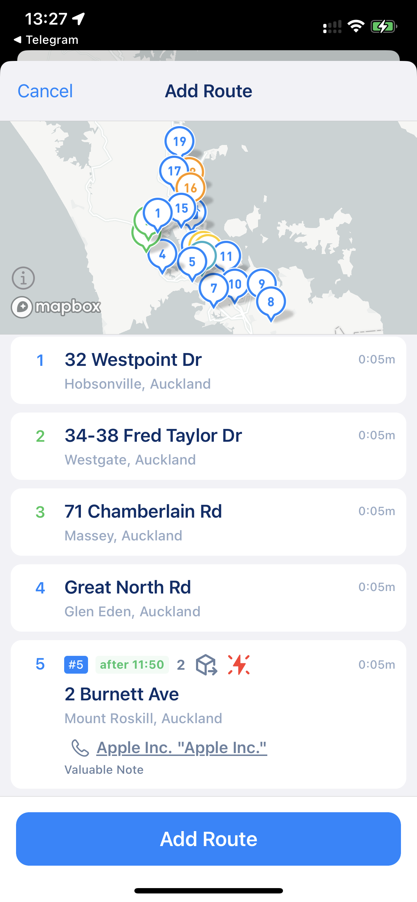

# Export your route and share it with others


**Using MyWay on Android?** This page describes the iOS app version 3. See [Version 2 of this page](https://help.mywayroute.com/guides/export-your-route-and-share-it-with-others).


You can export your route at any moment. Tap **…** in the route header and choose **Export & Share**. For a route in the Routes list, tap **…** next to the route and choose **Report**.

<figure><figcaption>
Export &#x26; Share
</figcaption></figure>

The Download Report screen gives you two kinds of results:

1. [Reports](export-your-route-and-share-it-with-others.md#files-export) (XLS, CSV, PDF): a report on your route. What it includes depends on the route status and the data you added to stops (completion status, proof photos, etc.).
2. [Manifest](export-your-route-and-share-it-with-others.md#get-manifest) and [Route Copy](export-your-route-and-share-it-with-others.md#share-route-copy): the manifest is a list of stops without statuses and proof. **Share Route Copy** creates a link to a copy of your route without status data (like delivery status and proof), so you can share it with others.


If you need a route report, PDF works best. To send your route to someone else, use [**Share Route Copy**](export-your-route-and-share-it-with-others.md#share-route-copy) rather than files.


## Export to a file (XLS, CSV, PDF) 

Tap **XLS**, **CSV** or **PDF** to export your route to a file: to pass information about your route to someone, save it for later, or provide a report (PDF). The PDF report also includes the proof of delivery photos. MyWay prepares the file and opens it, so you can save it to Files or share it.

<figure><figcaption>
Download Report
</figcaption></figure>

<figure><figcaption>
PDF Report Example
</figcaption></figure>


An exported XLS or CSV report is not a full copy of your route. If you import it back into MyWay, some stop settings (like time windows, shipment type, color, premises and email) are lost. To move a route to another device or person, use **Share Route Copy**.


## Get Manifest

**Get Manifest** creates a print-friendly PDF with the list of stops: tracking IDs, shipment type, time windows, package count, contact and notes, without statuses and proof. It's handy if you need to print your route and have the paper as a reference, or to pass the list of stops to someone who doesn't have the app.

<figure><figcaption>
Route Manifest
</figcaption></figure>

## Share Route Copy

If you want to share your route with someone else (like your driver or colleagues), we recommend **Share Route Copy**. It creates a route link that you can send to anyone by messenger, email, SMS, etc.

When the person opens the link on their iPhone with MyWay installed, MyWay asks "Import Route" ("Someone shared a route with you. Do you want to add it to your routes?"). The copy becomes their active route, with the stops and their settings, but without statuses and proof. If MyWay isn't installed, the link opens a web page where they can download it.

<figure><figcaption>
Share Route Copy
</figcaption></figure> <figure><figcaption>
Import Route
</figcaption></figure>

A shared route link is active for 30 days only. After that, we delete the route data from our server, so make sure the person you share it with has received and imported the route. We delete routes as per our privacy policy and to make sure all data belongs to you and no one else.


Links to routes shared from the previous version of MyWay still open in the new app, but without proof of delivery.



Keep in mind that by sharing routes with others, you might unintentionally share sensitive data. Anyone who has the link can open the route.

Before you share a file, make sure it doesn't contain sensitive data, and remove that data if necessary. Different export options include different data: pick the format you need, or delete the fields you don't need (for example, in the .XLS file).

