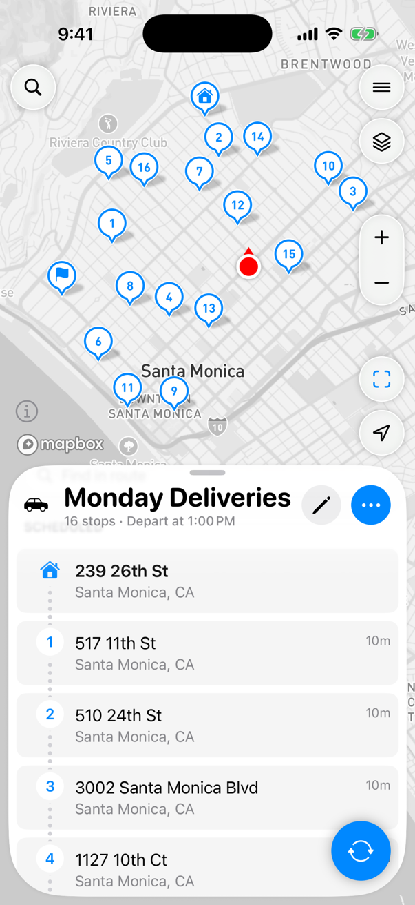
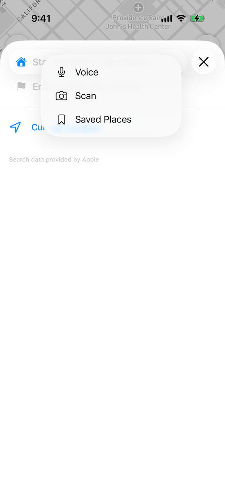
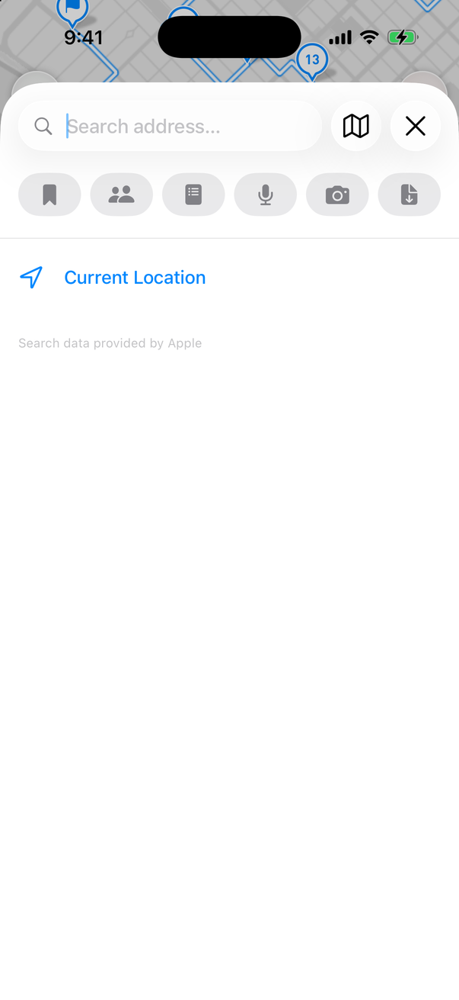
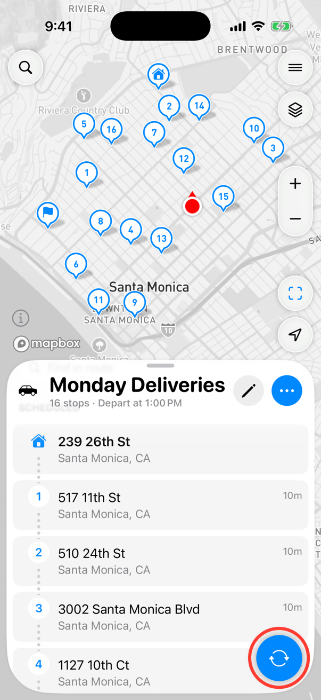
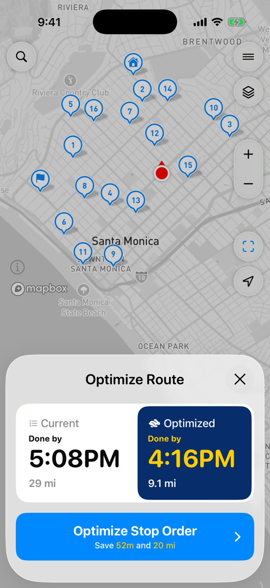
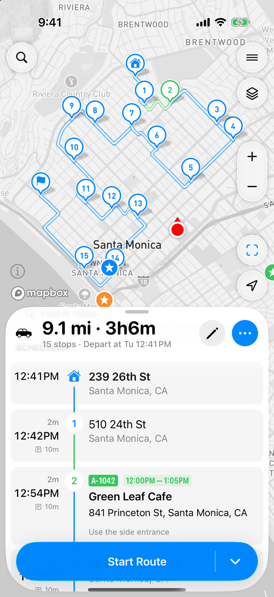
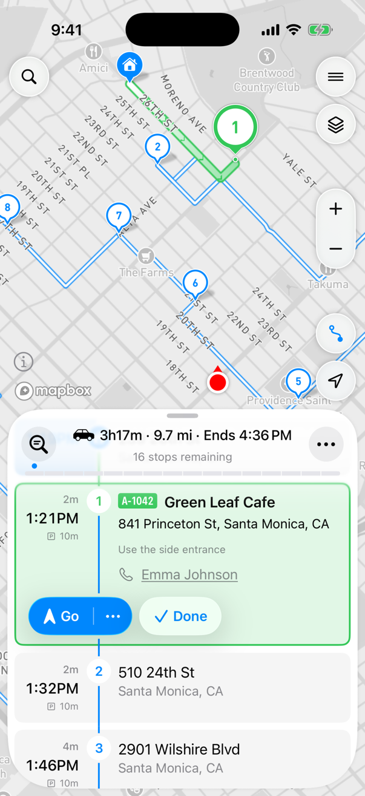
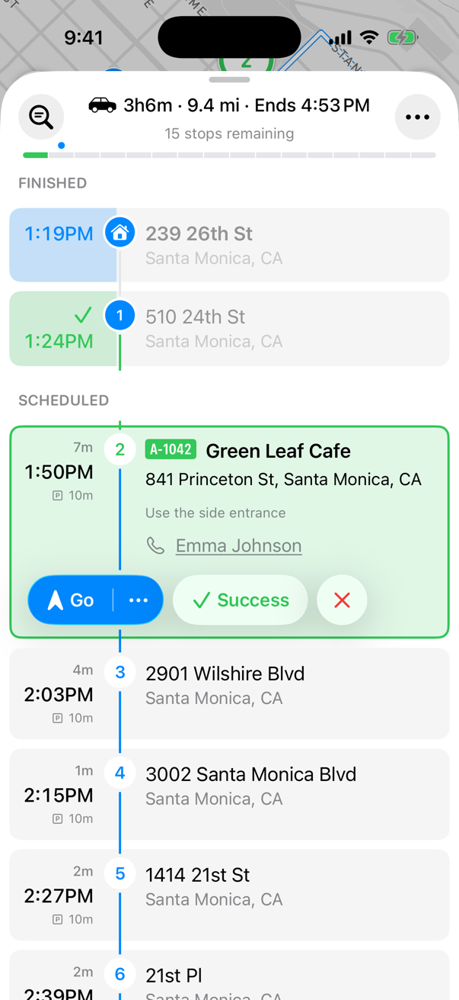
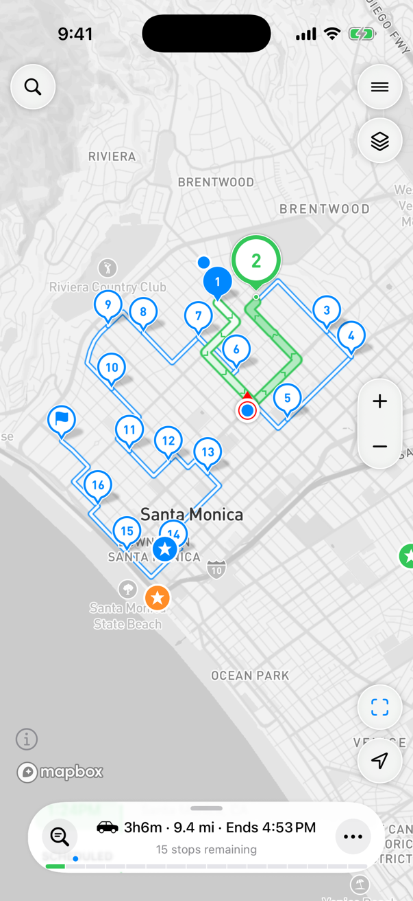
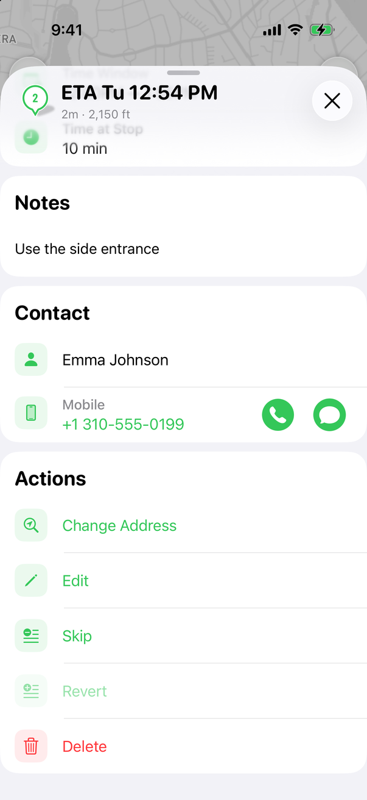

# How to use MyWay Route Planner


**Using MyWay on Android?** This page describes the iOS app version 3. See [Version 2 of this page](https://help.mywayroute.com/v2/guides/how-to-use-myway-route-planner).


This guide takes you from an empty route to the last stop. Less common options, like adding a stop by coordinates or by a point on the map, are in [How to use MyWay Route Planner: Advanced](how-to-use-myway-route-planner-advanced.md).

After you download the app from the [App Store](https://apps.apple.com/us/app/delivery-route-planner-myway/id1557014712) and open it, you see the main screen: a map with your route at the bottom.

## 1. Add the start and your stops 

<figure><figcaption>
Main Screen (Route Edit Mode)
</figcaption></figure>

1. Tap **Add Start Location** and choose where you begin, for example your depot or home. The start location is required. MyWay then asks where the route ends: tap **Return to Start** to finish where you started, or close the search to leave the end location empty. It's optional, and you can add it later with **Add End Location**.
2. Tap **Add Stop** (or the magnifier button in the top left corner of the map), type the address and tap the search result. MyWay adds the stop and closes the search.

To start or end at one of your [saved places](managing-your-contacts-and-places.md#places), tap **…** on the right of the empty start or end field, choose **Saved Places** and tap the place. The same **…** menu has **Voice** and **Scan**. If most of your routes start and end in the same places, set a default start and end location in [Default Route Settings](understand-route-settings.md#default-route-settings).

<figure><figcaption>
The … menu in the start field
</figcaption></figure>

### Add several stops in a row

When you tap **+** next to a search result, MyWay adds the stop, shows its settings below the search field and waits for the next address ("Add next stop…"). Tapping a search result now adds it as the next stop too, and the search stays open until you close it.

In this mode, the row of icons is replaced by **…** on the right of the empty field, with **Voice**, **Scan** and **Saved Places**. A saved place you choose there is added as the next stop, with all its settings.

### Other ways to add a stop

Besides the address search, you can add stops from other sources. While the search field is empty, they're shown as a row of icons under it, from left to right:

* **Saved Places** (bookmark): your [saved places](managing-your-contacts-and-places.md#places)
* **Contacts** (two people): addresses from your [iPhone contacts](managing-your-contacts-and-places.md#contacts)
* **List**: type or paste [up to 30 addresses at once](import-from-file-and-multi-line-import.md#multiline-import)
* **Voice** (microphone): say an address
* **Scan** (camera): read an address with the iPhone camera
* **Import** (document with an arrow): add stops [from an XLSX or CSV file](import-from-file-and-multi-line-import.md#import-from-file)

<figure><figcaption>
Add Stop options
</figcaption></figure>

Under the icons:

* **Current Location** adds the place where you are now.
* **Recents** lists the addresses you chose recently. As you type, the matching recent addresses appear above the search results. Swipe a recent address to remove it from the list.
* **Paste from Clipboard** adds a place from a link you copied in Google Maps or Apple Maps: MyWay opens the map at that point. Copied address text works too.

To add a stop by coordinates or by tapping a point on the map, see [more ways to add a stop](how-to-use-myway-route-planner-advanced.md#more-ways-to-add-a-stop).


Some addresses might not appear in the search results. If this happens, add more details: house number, city or ZIP code. If that doesn't help, tap **Select Geocoder** under "Can't find address?" and try a different address search provider. MyWay supports several of them, and [you can change it in the app settings](../i-cant-find-an-address.md#changing-data-provider-address-geocoding-service).


## 2. Check the route and stop settings 

**Route settings** are below the stops, under **Route Settings**: vehicle, departure time, road restrictions, side of road and optimization mode. Tap a setting to change it for this route only. If you use the same settings for most routes, make them the default, together with the default start and end locations. **Route settings are very important and can dramatically change your route time, distance and the way it looks.** [How each setting works](understand-route-settings.md)

**Stop settings**, like time window, priority, time at stop, notes and contact: tap a stop to open them. [How stop settings work](understanding-stop-settings.md)


**Optimize for Distance** can ignore stop settings like priority and time windows. Only **Optimize for Time** supports them in full.



When you add stops, pay attention to the warnings and errors MyWay shows you. For example, MyWay warns you about duplicate stops and about stops that are far away from the rest of the route or in another state or country. If you get an error, [our article explains what it means and how to sort it out](../faq/why-do-some-of-my-stops-have-issues-path-not-found-or-unexpected-error.md).


## 3. Optimize the route 

When you've added all stops, tap the optimize button: **the round blue button with two circular arrows at the bottom right of the screen, over the stop list.**

<figure><figcaption>
The optimize button
</figcaption></figure>

The optimize button isn't in the **…** menu. If you don't see it, pull the route panel up or tap **Done** if you're reordering stops. On a route in progress, use **…** > **Reoptimize Route** instead ([see below](#update-and-actualize-route)). A completed route can't be optimized until you tap **…** > **Edit Route**.

The button's icon spins while MyWay calculates; a long route can take a minute or more. To cancel, tap the button again. Then MyWay shows two versions of your route, each with the time you'll be done by, the distance and issues, if any:

* **Optimized** reorders the stops for the fastest or shortest route. It's selected by default.
* **Current** keeps the stop order exactly as you entered it.

Tap a version and then the button at the bottom: **Optimize Stop Order** (it also shows how much time and distance you save) or **Keep Stop Order**. MyWay applies the order and arrival times. To leave without changes, tap **X**. If the start location or stops are missing, MyWay shows where to add them. [More about optimization](understand-optimisation-settings.md)

<figure><figcaption>
Choose the stop order
</figcaption></figure>


Without a Premium subscription, you can use routes with up to 15 stops. For a longer route, you still see both versions, and MyWay offers Premium when you apply one. [How much does MyWay cost?](../what-is-myway-route-planner/how-much-does-myway-route-planner-cost.md)



Sometimes an optimized route takes more time or covers a longer distance than the route without optimization. This happens because optimization considers all stop settings: [time windows, priority and time at stop affect your route's overall time and distance](understanding-stop-settings.md). Our **algorithm builds the most efficient route possible, considering all these parameters**. It may only look less efficient than the current order, because the **current order simply ignores all parameters**. To learn more, see our [article that explains how the route optimization algorithm works](../faq/the-route-myway-produced-doesnt-look-correct.md).



MyWay shows you late arrivals and [issues](../faq/why-do-some-of-my-stops-have-issues-path-not-found-or-unexpected-error.md#stops-with-issues) so you can make informed decisions about what to do with them. In some cases, like tight time windows or conflicting stop priorities, the algorithm can't find an order that satisfies all parameters. Then the version shows the number of issues, and MyWay warns you that some stops have issues and may be skipped. Tap **Fix It** to apply that version and go to the first stop with a problem, so you can change it or skip it.


## 4. Start the route 

After you choose the stop order, the route header shows the route's total distance and time instead of its name, and the **Start Route** button appears in place of the optimize button. Tap it to start the route: MyWay recalculates it with the latest data, including time windows and traffic. To keep editing instead, tap the arrow next to **Start Route**. If you change the route (add, delete or move a stop, change a setting), the optimize button also comes back. Tap it again to rebuild the route.

<figure><figcaption>
Start Route button
</figcaption></figure>


You can still [change the route order, even after it's built](#making-route-changes-after-the-initial-route-is-built).


## 5. Follow the route 

The top of the route shows the time and distance left, the end time and how many stops remain. When no stops are left, it says "All Stops Completed". The current stop is highlighted:

* **Go** opens the stop in your navigation app. Tap **…** next to it for more options, like another navigation app or several stops at once. [Navigation settings](understand-navigation-settings.md)
* **Done** completes the stop and makes the next one current. The first time you tap it, MyWay asks if you want to turn on Proof of Delivery. With [Proof of Delivery](proof-of-delivery.md) on, you see **Success** and **Failed** instead of **Done**.
* To go to another stop first, tap it to see it on the map, then tap **Next** to make it the next stop.

<figure><figcaption>
Route - Main View
</figcaption></figure> <figure><figcaption>
Route - List View
</figcaption></figure> <figure><figcaption>
Route - Map View
</figcaption></figure>

The buttons on the right side of the map fit the whole route, the current segment or the current stop on the screen. The layers button (top right, below the menu button) chooses the map type and what the map shows: traffic, saved places, ETA labels and your location. [How to use the map](using-the-map.md)

### Stop actions

* **Swipe a stop to the right** to mark it **Arrived**, **Success** or **Failed**, or to **Undo** a completed stop.
* **Swipe a stop to the left** to **Delete**, **Skip** or **Revert** it. **Skip** takes the stop out of the route without deleting it and moves it to the Skipped section; **Revert** returns it to the route. On a route in progress, MyWay asks you to confirm, because the route and ETAs change.
* **Touch and hold a stop** to see all these actions in one menu, together with **Navigate**, **Edit**, **Details** and **Next**.
* **Open the stop's details**: tap the selected stop again. The statuses and proof are at the top, then the address, notes and contact, and the **Actions** section is at the bottom: **Change Address**, **Edit**, **Skip**, **Revert** and **Delete**. These buttons always ask you to confirm before they skip, revert or delete the stop. To close the details, tap **X** at the top.

<figure><figcaption>
Notes and Actions in the stop details
</figcaption></figure>

### Find a Stop

Where the search is depends on the route status:

* **While you plan a route**: pull the stop list down, and the **Find in route** bar appears at the top.
* **After you start the route**: tap the magnifier button on the left of the route header (**…** is on the right). There's no **Find in route** bar in the list.
* **In a completed route**: the **Find in route** bar is at the top of the stop list.

Type a name, address, company, note, tracking ID, phone, email or messenger. MyWay highlights the matching stops and shows how many there are (for example, 1/3); the up and down arrows move between them.

### Route Completed

To finish the route, tap **Complete Route** at the end of the stop list. MyWay shows "Route Completed!" with the share of completed stops and the number of stops done and successful. Tap **Continue** to see the route summary: date and time, progress, and **Copy Stops to New Route** to move the stops you missed to a new route. [Managing your routes](managing-your-routes.md)

## 6. Change the route after it's built 

You can change the route even after optimization: before you start it or while it's already in progress.

**Before you start the route**

Tap the arrow next to **Start Route** and make your changes. Then tap the optimize button and choose the stop order again.

**After you start the route**

To add one or two stops, tap the magnifier, find the stop and add it. MyWay puts it where it adds the least distance to the route: between two stops you haven't visited yet, or after the last one. Stops with the First or Last priority stay at the beginning or the end. To reorder stops, touch and hold a stop and drag it ([how this works with First and Last stops](understanding-stop-settings.md#priority-and-drag-and-drop)). Then [update the route](#update-and-actualize-route) to refresh the ETAs.

To change a stop's address, for example when the customer asks you to deliver somewhere else, open the stop's details and tap **Change Address** in the **Actions** section at the bottom. You can also do it in the [stop form](understanding-stop-settings.md#location-look-around-and-premises). Choose the new address, and MyWay saves it right away. Until you update the route, the times of this stop and the next ones are approximate ("\~"), and the map shows a dashed line to the stop instead of the road. Tap the optimize button and choose **Update Route** to recalculate the route and ETAs. You can't change the address of a stop that already has a status (Arrived, Success or Failed).

For bigger changes, use full edit mode:

1. Tap **…** in the route header and choose **Edit Route**. MyWay warns you that you'll have to start the route again; tap **Edit Route Anyway**.
2. Add, delete and reorder stops.
3. The route is back in planning, so tap the round optimize button and choose **Keep Stop Order** to keep your manual layout, or **Optimize Stop Order** to rebuild the most efficient route.

### Update the route 

If you're running late or have changed your route, update the ETAs or the stop order:

1. Tap **…** in the route header and choose **Reoptimize Route**. If the round optimize button is shown at the bottom right, you can tap it instead.
2. MyWay asks "How to reoptimize?". Choose **Update Route** to refresh the route and ETAs and keep the stop order, or **Reoptimize Route** to reorder all stops and build the optimal route. Then tap the button at the bottom.
3. **Update Route** applies right away; **Reoptimize Route** opens the **Optimize Route** screen, [as when you plan a route](#optimization-options-build-and-optimize-your-route).

[Read more about these options](understand-optimisation-settings.md#route-update-and-reoptimize)


If you have any questions, drop us a line through the online chat: in the MyWay app, open the menu (☰, top right) and tap **Talk to Us**.

