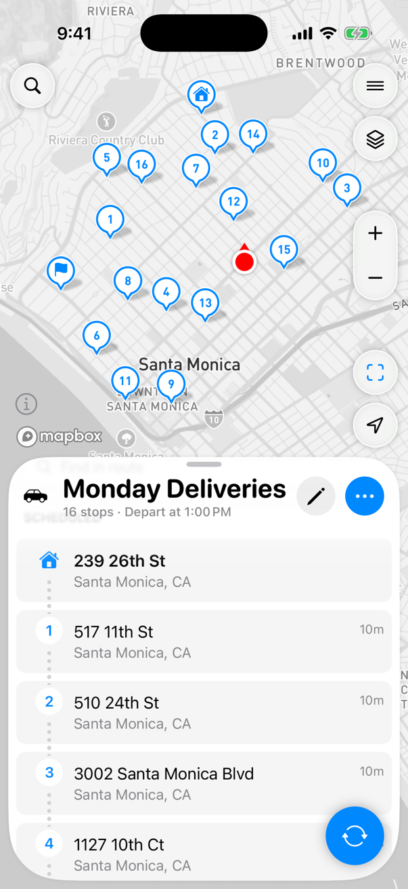
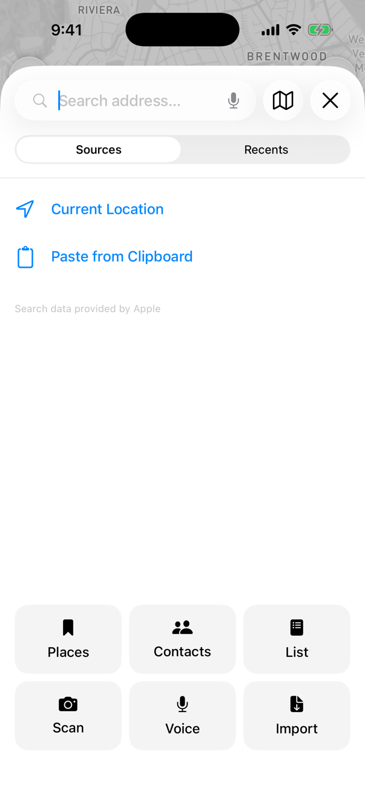
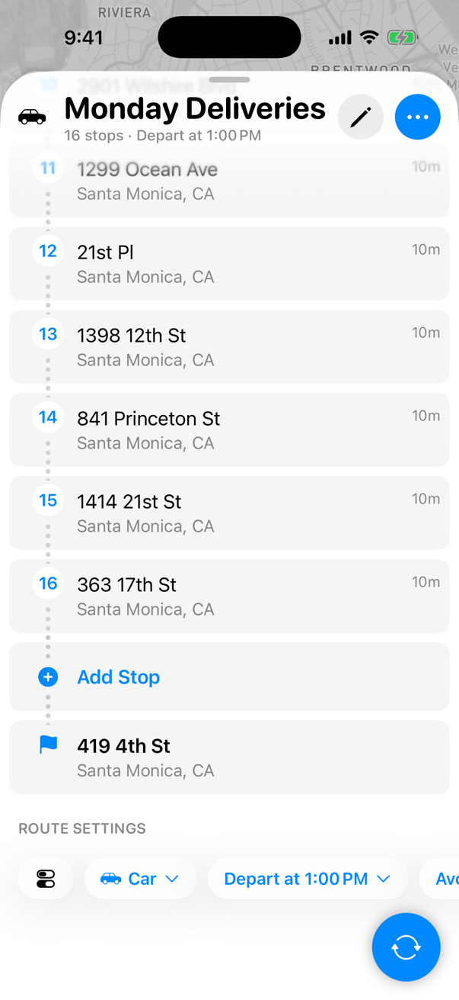
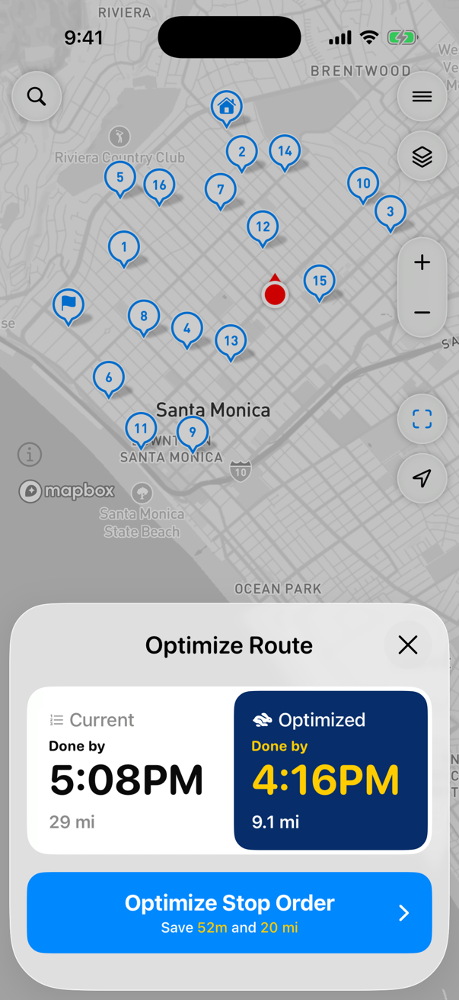
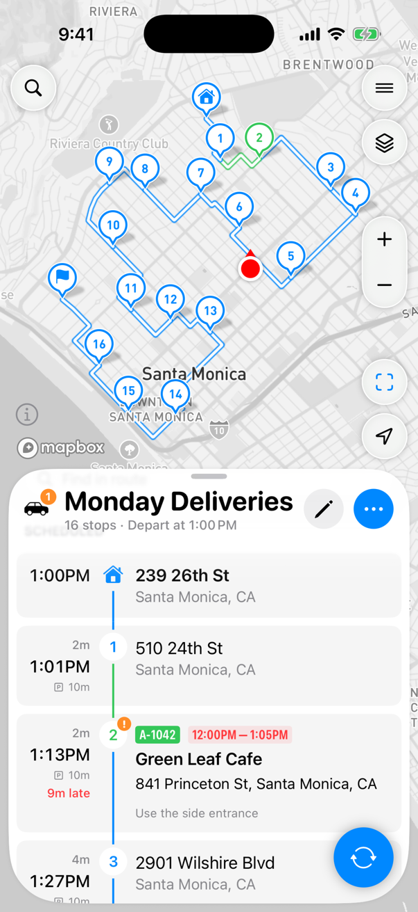
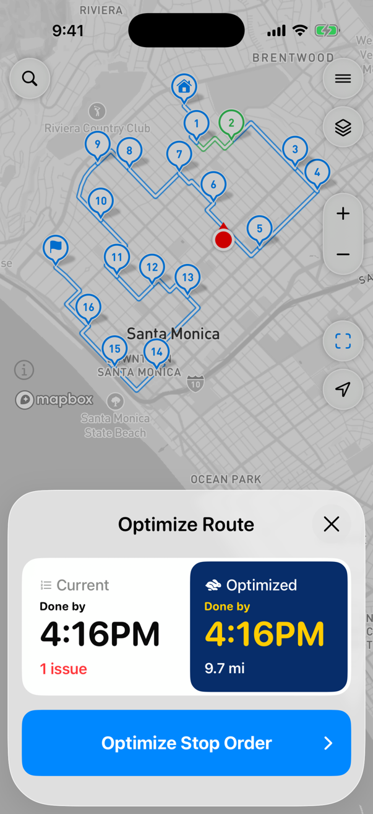
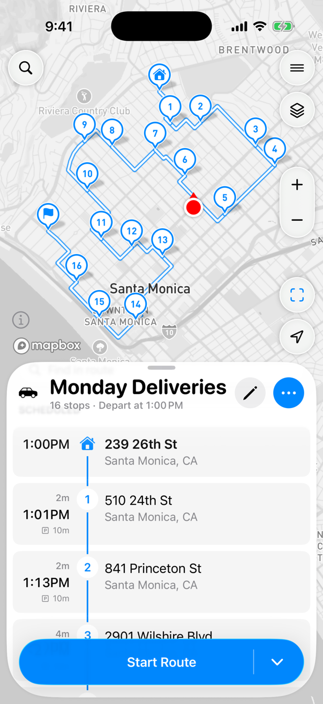
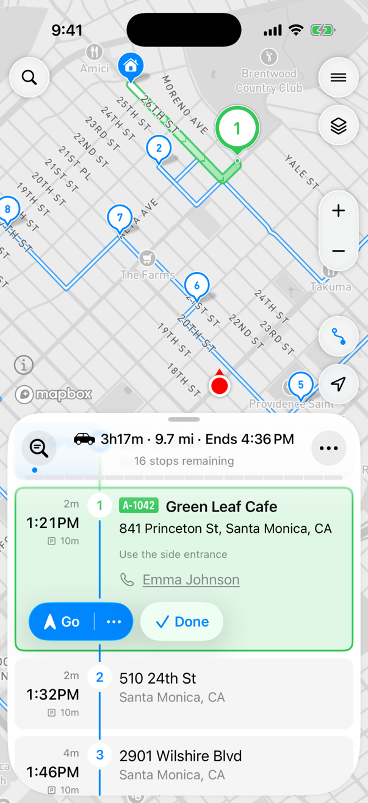
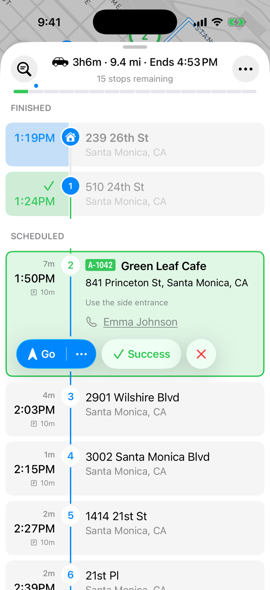
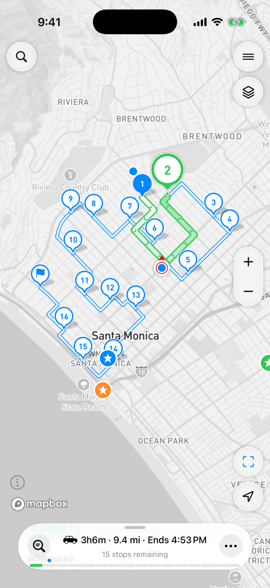

# How to use MyWay Route Planner


**Using MyWay on Android?** This page describes the iOS app version 3. See [Version 2 of this page](https://help.mywayroute.com/v2/guides/how-to-use-myway-route-planner).


The primary purpose of the MyWay Route Planner is to save you time and money by reducing the need for manual route planning and minimizing mileage traveled.

After you download the app from the [App Store](https://apps.apple.com/us/app/delivery-route-planner-myway/id1557014712) and open it, you see the main screen: a map with your route at the bottom.

## Build and Edit Routes

### Add Stops

<figure><figcaption>
Main Screen (Route Edit Mode)
</figcaption></figure>

Every route starts somewhere. Tap **Add Start Location** and choose where you begin, for example your depot or home. The start location is required.

MyWay then asks where the route ends. Tap **Return to Start** to finish where you started, or close the search to leave the end location empty: it's optional, and you can add it later with **Add End Location**.

Then add the places you need to visit with **Add Stop** or the magnifier button in the top left corner of the map. Tap a search result to add the stop and close the search, or tap **+** next to it to add the stop and keep searching for the next one.

If most of your routes start and end in the same places, set a default start and end location in [Route Settings](#route-settings).

Besides the address search, the **Add Stop** screen lets you add stops from:

* **Places**: your [saved places](managing-your-contacts-and-places.md#places)
* **Contacts**: addresses from your [iPhone contacts](managing-your-contacts-and-places.md#contacts)
* **List**: type or paste [up to 30 addresses at once](import-from-file-and-multi-line-import.md#multiline-import)
* **Scan**: read an address with the iPhone camera
* **Voice**: say an address
* **Import**: add stops [from an XLSX or CSV file](import-from-file-and-multi-line-import.md#import-from-file)

<figure><figcaption>
Add Stop options
</figcaption></figure>

### More ways to add a stop

* **Where you are now**: tap **Current Location**.
* **An address you used before**: open the **Recents** tab.
* **A map link**: copy a link to a place in Google Maps or Apple Maps and tap **Paste from Clipboard**. MyWay opens the map at that point. Copied address text works too.
* **Coordinates**: type or paste them into the search field, for example 34.0407, -118.2468, and choose **Search coordinate**.
* **A point on the map**: tap the map button next to the search field and tap the place. The stop stays exactly where you tapped; if the nearest address is far from that point, MyWay tells you how far.
* **Add and edit at once**: on the map, **Add stop and edit** adds the stop and opens its settings right away.
* **Voice in another language**: in **Voice**, tap the language and choose it before you speak.
* **A route someone shared with you**: open the [shared link](export-your-route-and-share-it-with-others.md#share-route-copy) to add it.


**Scan** uses Live Text. If MyWay doesn't recognize the text, check that your iPhone and your language support Live Text ([Apple guide](https://support.apple.com/en-au/guide/iphone/aside/iph691752bc0/17.0/ios/17.0), [supported languages](https://www.apple.com/ios/feature-availability/#live-text-live-text)). **Voice** asks for access to the microphone and speech recognition the first time you use it.



Some addresses might not appear in the search results. If this happens, add more details: house number, city or ZIP code. If that doesn't help, tap **Select Geocoder** under "Can't find address?" and try a different address search provider. MyWay supports several of them, and [you can change it in the app settings](../i-cant-find-an-address.md#changing-data-provider-address-geocoding-service).


## Route Settings

While you plan a route, its settings are shown below the stops, under **Route Settings**. Tap a setting to change it for this route only:

* **Vehicle**: what you drive, for example Car. See [Vehicle Settings](understand-vehicle-settings.md).
* **Departure time**: the route departs now by default. To plan it for later, tap **Depart now**, pick a date and time and tap **Done**. **Clear** switches back to departing now.
* **Road Restrictions**: roads to [avoid](#road-restrictions), such as toll roads.
* **Side of Road**: Any Side, Same Side as Stop or Across from Stop, for all stops in the route.
* **Optimization mode**: [Optimize for Time or Optimize for Distance](#optimization-mode).

Swipe the row to the left to see all settings. A highlighted setting means this route differs from the standard value, for example when you set a departure time or a road to avoid (the vehicle is always highlighted). You can change these settings only while you plan the route; after you start it, they're hidden.

**Route settings are very important and can dramatically change your route time, distance and the way it looks.** Take some time to experiment with them, because there is no one-size-fits-all solution.

<figure><figcaption>
Route Settings
</figcaption></figure>


**A tip from us:** you can plan a route in advance. Set the departure time, and MyWay calculates the ETAs from it. After you tap **Start Route**, the start location stays the current step with its own **Start Route** button. Tap it only when you actually leave: MyWay marks the start as done and recalculates all ETAs from that moment. This keeps your ETAs accurate and the traffic data up to date.


### Default Route Settings

If you use the same settings for most routes, make them the default. The first button in the row (with two switches) opens the default **Route Settings**, which MyWay applies to new routes:

* vehicle, side of road, optimization mode and road restrictions;
* **Time at Stop**: the default time for new stops;
* **Start & End Locations**: the default start and end for new routes.

Tap the check mark to save. MyWay also applies the new defaults to the current route, but only to the settings you haven't changed for this route. For example, if your default vehicle was Car and you change it to Van, a route that still uses Car becomes Van, while a route where you chose Truck yourself stays Truck.

### Optimization Mode

**One of the most impactful settings for route planning is Optimization Mode**, which offers two options: **Optimize for Time** and **Optimize for Distance**. This setting affects both the optimized route and the order of your stops.

**Optimizing for time is recommended in 90% of cases.** It works similarly to most navigation apps, focusing on efficiency rather than the shortest path. While the route might be slightly longer in distance, it's typically faster, more fuel-efficient and more convenient. These routes usually involve fewer turns, traffic lights and route changes.

Optimizing for distance prioritizes the shortest possible route, even if it sacrifices time and convenience. Routes optimized this way often include more turns, traffic lights and unpaved roads. While it's less practical for most users, it can be useful for drivers who know the area very well.

### Road Restrictions

Road restrictions let you avoid highways, ferries, toll roads or unpaved roads. Some of these roads might be necessary to complete the route, so MyWay can't always avoid them. When it can't, it keeps their use to a minimum.


MyWay doesn't pass road restrictions to navigation apps. Set the same options in your navigation app, otherwise it may lead you along the roads you wanted to avoid.


## Stop's Settings

Each stop has its own [settings, like time windows, priority, notes and color](understanding-stop-settings.md). To open them, tap the stop in the route. While you follow a route, the first tap selects the stop and shows it on the map; tap it again to open its details.


**Optimize for Distance** can ignore stop settings like priority and time windows. Only **Optimize for Time** supports them in full.



When you add stops, pay attention to the warnings and errors MyWay shows you. For example, MyWay warns you about duplicate stops and about stops that are far away from the rest of the route or in another state or country. If you get an error, [our article explains what it means and how to sort it out](../faq/why-do-some-of-my-stops-have-issues-path-not-found-or-unexpected-error.md).


MyWay also supports multi-day routes. [Here's how to build them](planning-multi-day-routes.md).

When you've added all stops and chosen the route settings, tap the round blue button with arrows at the bottom right. MyWay builds the route and asks you to choose the stop order.


Without a Premium subscription, you can use routes with up to 15 stops. For a longer route, MyWay offers you Premium when you choose the stop order. [How much does MyWay cost?](../what-is-myway-route-planner/how-much-does-myway-route-planner-cost.md)


## Optimization Options (Build and Optimize your route)

MyWay shows two versions of your route, each with the time you'll be done by and the distance:

* [**Current keeps the stop order**](understand-optimisation-settings.md#optimize-reoptimize-route-settings) exactly as you entered it, with no optimization applied.
* [**Optimized**](understand-optimisation-settings.md#optimize-reoptimize-route-settings) **automatically reorders the stops for the fastest or shortest route**, based on your optimization mode.

Tap a version, then tap **Keep Stop Order** (for Current) or **Optimize Stop Order** (for Optimized). The button also shows how much time and distance the optimized order saves.

<figure><figcaption>
Choose the stop order
</figcaption></figure>


Sometimes an optimized route takes more time or covers a longer distance than the route without optimization. This happens because optimization considers all stop settings: [time windows, priority and time at stop affect your route's overall time and distance](understanding-stop-settings.md). Our **algorithm builds the most efficient route possible, considering all these parameters**. It may only look less efficient than the current order, because the **current order simply ignores all parameters**. To learn more, see our [article that explains how the route optimization algorithm works](../faq/the-route-myway-produced-doesnt-look-correct.md).



MyWay shows you late arrivals and [issues](../faq/why-do-some-of-my-stops-have-issues-path-not-found-or-unexpected-error.md#stops-with-issues) so you can make informed decisions about what to do with them. In some cases, like tight time windows or conflicting stop priorities, the algorithm can't find an order that satisfies all parameters. Then the version shows the number of issues, and MyWay warns you that some stops have issues and may be skipped. Tap **Fix It** to apply that version and go to the first stop with a problem, so you can change it or skip it.


<figure><figcaption>
Late Arrival
</figcaption></figure> <figure><figcaption>
Issue warning
</figcaption></figure>


Our users also told us that some apps "build your route anyway" and show you those missed stops after the fact. It creates a feeling that everything is okay until it's not. We show you this so you can decide what to do before it's too late.


### Confirm your Route

After you choose the stop order, MyWay shows the **Start Route** button. If you're done planning, tap it to start the route. To keep editing, tap the arrow next to **Start Route**: the button hides, and you can add stops or change settings. Then tap the round blue button again to rebuild the route.

When you tap **Start Route**, MyWay recalculates the route using the latest data, including time windows, traffic and other factors.

<figure><figcaption>
Start Route button
</figcaption></figure>


You can still [change the route order, even after it's built](how-to-use-myway-route-planner.md#making-route-changes-after-the-initial-route-is-built).


## Follow Route

After you start the route, the top of the route shows the time and distance left, the end time and how many stops remain. The current stop is highlighted:

* **Go** opens the stop in your navigation app. Tap **…** next to it to navigate by GPS coordinates or by address, choose another navigation app, or navigate through several stops at once. [Read more about navigation](understand-navigation-settings.md).
* **Done** completes the stop and makes the next one current. The first time you tap it, MyWay asks if you want to turn on Proof of Delivery. With [Proof of Delivery](proof-of-delivery.md) on, you see **Success** and **Failed** instead of **Done**.
* To go to another stop first, tap it to see it on the map, then tap **Next** to make it the next stop.
* Touch and hold a stop for more actions, for example to skip it.

### Stop actions

* **Swipe a stop to the right** to mark it **Arrived**, **Success** or **Failed**, or to **Undo** a completed stop.
* **Swipe a stop to the left** to **Delete**, **Skip** or **Revert** it. **Skip** takes the stop out of the route without deleting it and moves it to the Skipped section; **Revert** returns it to the route.
* **Touch and hold a stop** to see all these actions in one menu, together with **Navigate**, **Edit**, **Details** and **Next**.
* **Find a stop**: expand the route panel and use the **Find in route** field above the stop list. It searches addresses, names, tracking IDs, phones, emails and messengers.
* **Finish the route**: tap **Complete Route** at the end of the list.

<figure><figcaption>
Route - Main View
</figcaption></figure> <figure><figcaption>
Route - List View
</figcaption></figure> <figure><figcaption>
Route - Map View
</figcaption></figure>

### Route Completed

When you complete a route, MyWay shows "Route Completed!" with the share of completed stops and the number of stops done and successful. Tap **Continue** to see the route summary: date and time, progress, and **Copy Stops to New Route** to move the stops you missed to a new route.

From time to time, after you complete a route, MyWay asks "How was your route?". Tap **All Good** and then **Rate Us** to rate the app in the App Store, or **Had Issues** and then **Send Feedback** to tell us what went wrong: the chat opens with this route attached.

### The Map

The buttons on the right side of the map fit the whole route, the current segment or the current stop on the screen. The layers button (top right, below the menu button) chooses the map type and what the map shows: traffic, saved places, ETA labels and your location. [How to use the map](using-the-map.md)

### Update and Actualize Route

If you're running late or have changed your route, update the ETAs or the stop order:

1. Tap **…** in the route header and choose **Reoptimize Route**.
2. Choose **Update Route** to refresh the route and ETAs and keep the stop order, or **Reoptimize Route** to reorder all stops and build the optimal route.

[Read more about these options](understand-optimisation-settings.md#route-update-and-reoptimize).

## Making route changes after the initial route is built

You can change the route even after optimization: before you start it or while it's already in progress.

**Before you start the route**

Tap the arrow next to **Start Route** and make your changes. Then tap the round blue button and choose **Keep Stop Order** to keep your own stop sequence, or **Optimize Stop Order**.

**After you start the route**

To add one or two stops, tap the magnifier, find the stop and add it. MyWay inserts it next to the closest part of the route. To reorder stops, touch and hold a stop and drag it. Then [update the route](#update-and-actualize-route) to refresh the ETAs.

For bigger changes, use full edit mode:

1. Tap **…** in the route header and choose **Edit Route**. MyWay warns you that you'll have to start the route again; tap **Edit Route Anyway**.
2. Add, delete and reorder stops.
3. Tap the round blue button and choose **Keep Stop Order** to keep your manual layout, or **Optimize Stop Order** to rebuild the most efficient route.


If you have any questions at this stage, drop us a line through the online chat: in the MyWay app, open the menu (☰, top right) and tap **Talk to Us**.

