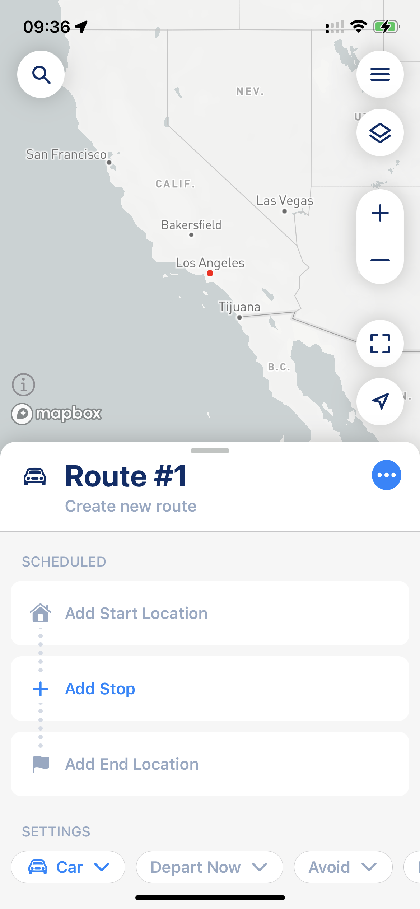
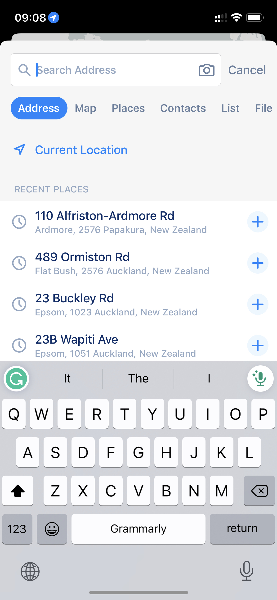
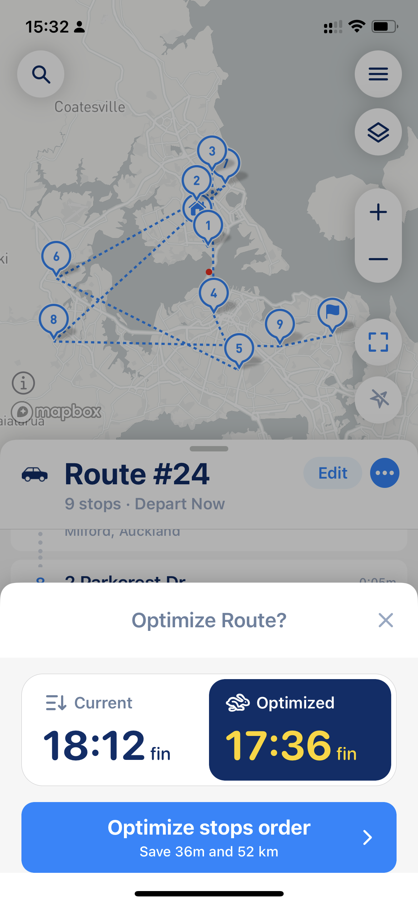
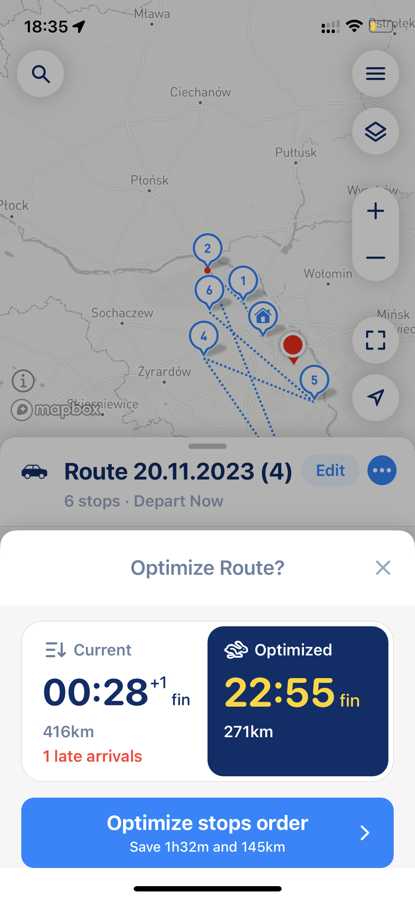
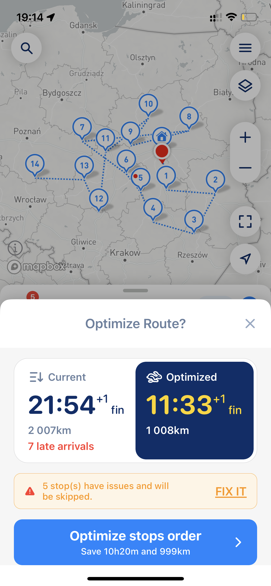
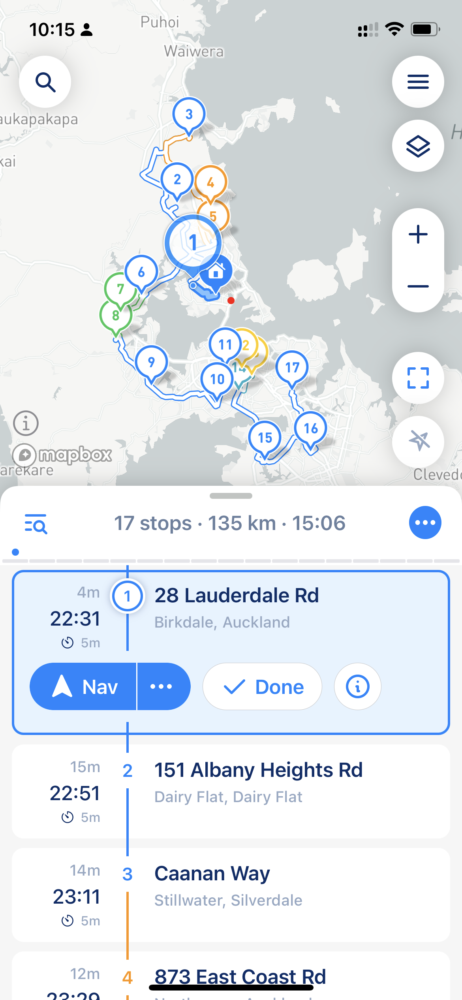
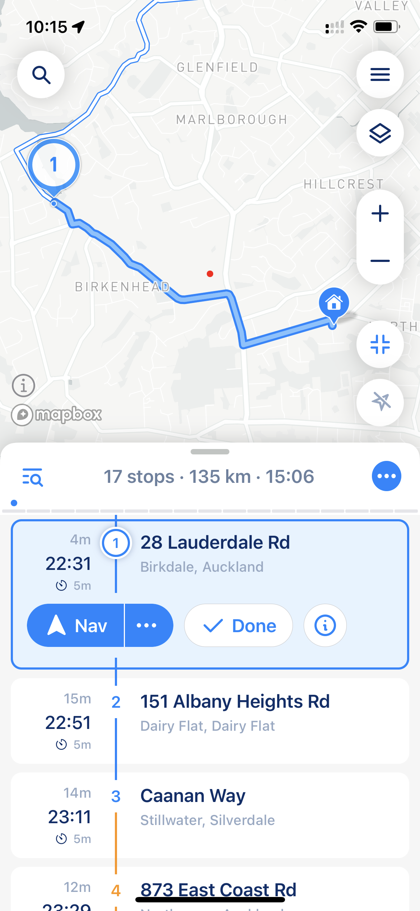
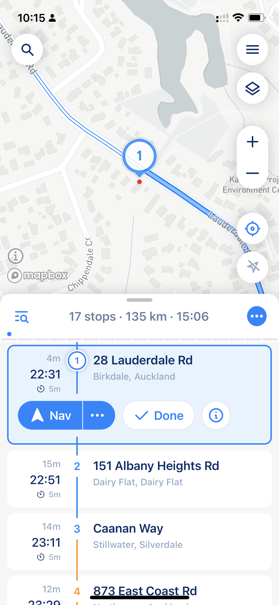
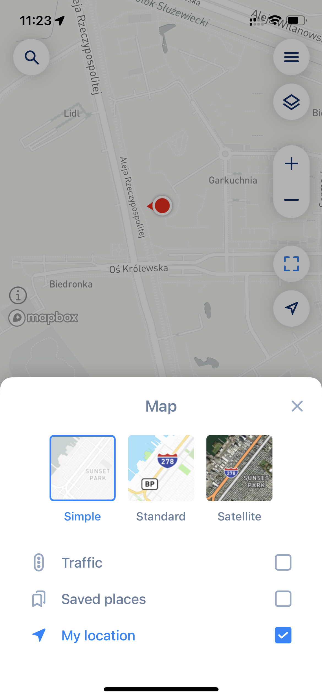

# How to use MyWay Route Planner


**Using MyWay on Android?** This page describes the iOS app version 3. See [Version 2 of this page](https://help.mywayroute.com/guides/how-to-use-myway-route-planner).


The primary purpose of the MyWay Route Planner is to save you time and money by reducing the need for manual route planning and minimizing mileage traveled.

After you download the app from the [App Store](https://apps.apple.com/us/app/delivery-route-planner-myway/id1557014712) and open it, you see the main screen: a map with your route at the bottom.

## Build and Edit Routes

### Add Stops

<figure><figcaption>
Main Screen (Route Edit Mode)
</figcaption></figure>

A route has a start location (required), any number of stops, and an end location (optional). Tap "Add Start Location", "Add Stop" or "Add End Location" in the route, or tap the magnifier button in the top left corner of the map.

After you set the start location, MyWay asks for the end location. Tap "Return to Start" to finish where you started, or close the search to leave the end location empty. You can also set a default start and end location for all new routes in [Route Settings](#route-settings).

Besides the address search, the "Add Stop" screen offers "Current Location", "Paste from Clipboard" and these sources:

* **Places**: your [saved places](managing-your-contacts-and-places.md#places)
* **Contacts**: addresses from your [iPhone contacts](managing-your-contacts-and-places.md#contacts)
* **List**: type or paste [up to 30 addresses at once](import-from-file-and-multi-line-import.md#multiline-import)
* **Scan**: read addresses with the iPhone camera
* **Voice**: say an address
* **Import**: add stops [from an XLSX or CSV file](import-from-file-and-multi-line-import.md#import-from-file)

The "Recents" tab shows addresses you used before. To pick a point on the map, tap the map button next to the search field. You can also add a route that someone [shared with you as a link](export-your-route-and-share-it-with-others.md#share-route-copy).

<figure><figcaption>
Add Stop options
</figcaption></figure>

Tap a search result to add the stop and close the search. Tap "+" next to a result to add the stop and keep searching for the next one.


**Scan** uses Live Text. If MyWay doesn't recognize the text, check that your iPhone and your language support Live Text ([Apple guide](https://support.apple.com/en-au/guide/iphone/aside/iph691752bc0/17.0/ios/17.0), [supported languages](https://www.apple.com/ios/feature-availability/#live-text-live-text)). **Voice** asks for access to the microphone and speech recognition the first time you use it.



Some addresses might not appear in the search results. If this happens, add more details: house number, city or ZIP code. If the issue persists, tap "Select Geocoder" under "Can't find address?" and try a different geocoding provider. MyWay supports several address geocoding providers, and [you can change it in the app settings](../i-cant-find-an-address.md#changing-data-provider-address-geocoding-service).


## Route Settings

Below the stops, under "Route Settings", you can find the settings of the current route:

* **Vehicle** (for example, "Car"): see [Vehicle Settings](understand-vehicle-settings.md)
* **Departure time**: "Depart now" or "Depart at…"
* **"Road Restrictions"**: what to [avoid](#road-restrictions)
* **"Side of Road"**: "Any Side", "Same Side as Stop" or "Across from Stop", for all stops in the route
* **[Optimization mode](#optimization-mode)**: "Optimize for Time" or "Optimize for Distance"

You can change these settings only while you plan the route, not after you start it.

The first button in this row opens the default Route Settings for new routes: Vehicle, Side of Road, Optimization Mode, Road Restrictions and Time at Stop, and your default "Start & End Locations".

**Route settings are very important and can dramatically change your route time, distance and the way it looks**. Take some time to experiment with them, because there is no one-fits-all solution.

<figure><figcaption>
Route Settings
</figcaption></figure>


You can plan a route in advance: set the departure time, and MyWay calculates the ETAs from it. After you tap "Start Route", the start location stays the current step with its own "Start Route" button. Tap it only when you actually leave: MyWay marks the start as done and recalculates all ETAs from that moment. This ensures accurate ETAs and up-to-date traffic data.


### Optimization Mode

**One of the most impactful settings for route planning is Optimization Mode**, which offers two options: "Optimize for Time" and "Optimize for Distance". This setting affects both the optimized route and the order of your stops.

**Optimizing for time is recommended in 90% of cases.** It works similarly to most navigation apps, focusing on efficiency rather than the shortest path. While the route might be slightly longer in distance, it's typically faster, more fuel-efficient, and more convenient. These routes usually involve fewer turns, traffic lights, and route changes.

Optimizing for distance prioritizes the shortest possible route, even if it sacrifices time and convenience. Routes optimized this way often include more turns, traffic lights, and unpaved roads. While it's less practical for most users, it can be useful for drivers who are highly familiar with the area.

### Road Restrictions

Road restrictions let you avoid highways, ferries, toll roads or unpaved roads. However, some of these roads might be necessary to complete the route, so exclusions aren't always guaranteed. If avoiding a road isn't possible, MyWay still keeps its use to a minimum.


MyWay doesn't pass road restrictions to navigation apps. Set the same options in your navigation app, otherwise it may lead you through the roads you wanted to avoid.


## Stop's Settings

Each stop has [stop settings like time windows, priority, notes, color, etc.](understanding-stop-settings.md) To open them, tap the stop in the route. While you follow a route, the first tap selects the stop and shows it on the map; tap it again to open its details.


Please remember that "Optimize for Distance" can ignore stop settings like priority and time windows. The only option that supports time windows and priority in full is "Optimize for Time".



_When you add stops, please pay attention to the warnings and errors MyWay shows you. For example, MyWay warns you about duplicate stops and stops that are far away from the rest of the route or in another state or country. If you get any errors, please check_ [_our article that explains what they mean and how to get them sorted_](../faq/why-do-some-of-my-stops-have-issues-path-not-found-or-unexpected-error.md)_._


MyWay Route Planner also supports multi-day routes. If you want to know how to build them, please [check this article](planning-multi-day-routes.md).

After you add all stops and choose the route settings, tap the round blue button with arrows at the bottom right. MyWay builds the route and shows the "Optimize Route" options.


Without a Premium subscription, you can use routes with up to 15 stops. For a longer route, MyWay offers you Premium when you choose the stop order. [How much does MyWay cost?](../what-is-myway-route-planner/how-much-does-myway-route-planner-cost.md)


## Optimization Options (Build and Optimize your route)

"Optimize Route" shows two versions of your route, each with the time you will be done by and the distance:

• [**Current keeps the stop order**](understand-optimisation-settings.md#optimize-reoptimize-route-settings) exactly as you entered it, with no optimization applied.

• [**Optimized**](understand-optimisation-settings.md#optimize-reoptimize-route-settings) **automatically reorders the stops for the fastest or shortest route**, based on your optimization mode.

Tap a version, then tap "Keep Stop Order" (for Current) or "Optimize Stop Order" (for Optimized). The button also shows how much time and distance the optimized order saves.


Sometimes, an optimized route traveling time or distance can be more significant or take more time than the route without optimization. It happens because optimization considers all stop parameters. [Parameters like "time windows," "priority," and "time at stop" will affect your route's overall time and distance](understanding-stop-settings.md). Our **algorithm built the most efficient route possible, considering all these parameters**. It just may look like it is less efficient than the current order, as the **current order simply ignores all parameters**. If you want more about this, please check our [article that explains how the route optimization algorithm works](../faq/the-route-myway-produced-doesnt-look-correct.md).



MyWay will show you late arrivals and [issues](../faq/why-do-some-of-my-stops-have-issues-path-not-found-or-unexpected-error.md#stops-with-issues) so you can make informed decisions about what to do with them. In some cases, like tight time windows or conflicting stop priorities, the algorithm can't find an order that satisfies all parameters. Then the version shows the number of issues, and MyWay warns you that some stops have issues and may be skipped. Tap "Fix It" to apply that version and go to the first stop with a problem, so you can change it (or simply skip it).


<figure><figcaption>
Late Arrival
</figcaption></figure> <figure><figcaption>
Optimization Warning
</figcaption></figure>


Our users also told us that some apps "build your route anyway" and show you those missed stops after the fact. It creates a feeling that everything is okay until it's not. We show you this so you can decide what to do before it's too late.


### Confirm your Route

After you choose the stop order, MyWay shows the "Start Route" button. If you're done planning, tap it to start the route. If you want to keep editing, tap the arrow next to "Start Route": the button hides, and you can add stops or change settings. Then tap the round blue button again to rebuild the route.

Once you tap "Start Route", the app will recalculate the route using the latest data, including time windows, traffic, and other factors.

<figure><figcaption>
Start Route button
</figcaption></figure>


If you want to modify the route after the app builds the stop order, you can still [change the route order, even after it's built](how-to-use-myway-route-planner.md#making-route-changes-after-the-initial-route-is-built).


## Follow Route

After you start the route, the top of the route shows the remaining time, distance, end time and the number of stops left. The current stop is highlighted:

* "Go" opens the stop in your navigation app. Tap "…" next to it to open "Navigation to Stop": there you can navigate by GPS coordinates or by address, choose the navigation app, or navigate through several stops at once. [Read more about navigation](understand-navigation-settings.md).
* "Done" closes the stop and makes the next one current. The first time you tap it, MyWay asks if you want to turn on Proof of Delivery. With [Proof of Delivery](proof-of-delivery.md) on, you see "Success" and "Failed" instead of "Done".
* Tap another stop to select it and see it on the map. "Next" makes it the next stop.
* Touch and hold a stop for more actions, for example, to skip it.
* "Complete Route" at the end of the list finishes the route.

<figure><figcaption>
Route - Main View
</figcaption></figure> <figure><figcaption>
Route - List View
</figcaption></figure> <figure><figcaption>
Route - Map View
</figcaption></figure>

### Fitting Modes

The fitting mode automatically adjusts the map view to show the most relevant part of your route. MyWay offers three modes:

1. Whole route: shows the entire route on the screen.
2. Current segment: shows the way from your last stop to the next one.
3. Current stop: zooms in on the next stop.

**How to use:** tap the button above the location button on the right side of the map. While you follow a route, each tap switches to the next mode. While you plan a route, the button shows the whole route.

<figure><figcaption>
Whole route
</figcaption></figure> <figure><figcaption>
Current segment
</figcaption></figure> <figure><figcaption>
Current stop
</figcaption></figure>

To make the map follow your position, tap the location button at the bottom right of the map.

### Your Location

You can hide your current location to make it easier to work with the route. It's handy when you build and manage routes outside of your area. To hide your location, tap the layers button (top right, below the menu button) and turn off "My Location".

<figure><figcaption>
My Location in the map layers
</figcaption></figure>

When you follow your route and ["update"](how-to-use-myway-route-planner.md#update-and-actualize-route) it to actualize ETAs, and "My Location" is on, MyWay takes your location as an "intermediate starting" point. That greatly improves ETA calculation and builds a much more accurate route. When "My Location" is off, MyWay calculates from your last completed stop. Using your location can cause issues when you are in a different country or in a place that can't be reached by public roads. We recommend checking [Optimisation Settings](understand-optimisation-settings.md#starting-location) to see how location can affect your routes.

### Update and Actualize Route

If you see that you are running late or have changed your route, you can update all ETAs or the stop order. Tap the "…" button in the route header and choose "Reoptimize Route". In "How to reoptimize?", pick:

* "Update Route" to refresh the route and ETAs and keep the stop order;
* "Reoptimize Route" to reorder all stops and build the optimal route.

[Read more about those options](understand-optimisation-settings.md#route-update-and-reoptimize).

## Making route changes after the initial route is built

MyWay lets you make changes even after optimization: before you start the route or while it's already in progress.

**Modify Route Before Starting**

If you've already chosen an order but want to make adjustments before starting, tap the arrow next to "Start Route". Make your changes, then tap the round blue button and choose "Keep Stop Order" to keep your own stop sequence, or "Optimize Stop Order".

**Modify Route After Starting**

**Quick Add & Reorder:** Need to drop in one or two extra stops? Tap the magnifier, find the stop and add it. MyWay inserts it next to the closest part of the route. Touch and hold a stop, then drag it to reorder. Then [update the route](#update-and-actualize-route) to refresh the ETAs.

**Full Edit Mode:** For multiple changes, tap "…" in the route header and select "Edit Route". MyWay warns you that you'll have to start the route again; tap "Edit Route Anyway". Add, delete and reorder stops, then tap the round blue button and choose:

• "Keep Stop Order" to keep your manual layout

• "Optimize Stop Order" to rebuild the most efficient route


If at this stage you have any questions, please drop us a line through online chat. In the MyWay app, tap the menu button (three lines, top right corner) and then "Talk to Us".

