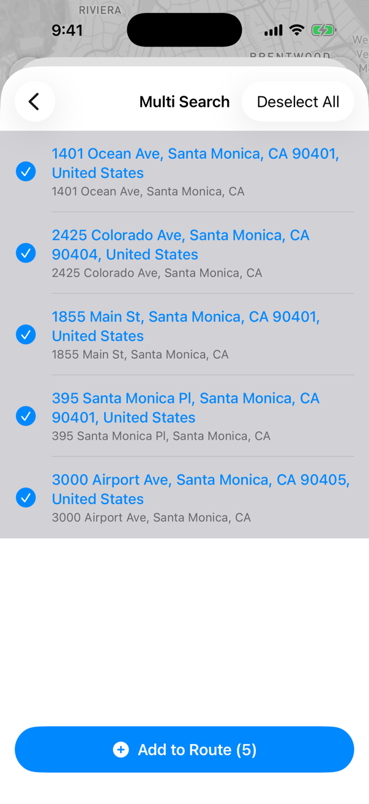
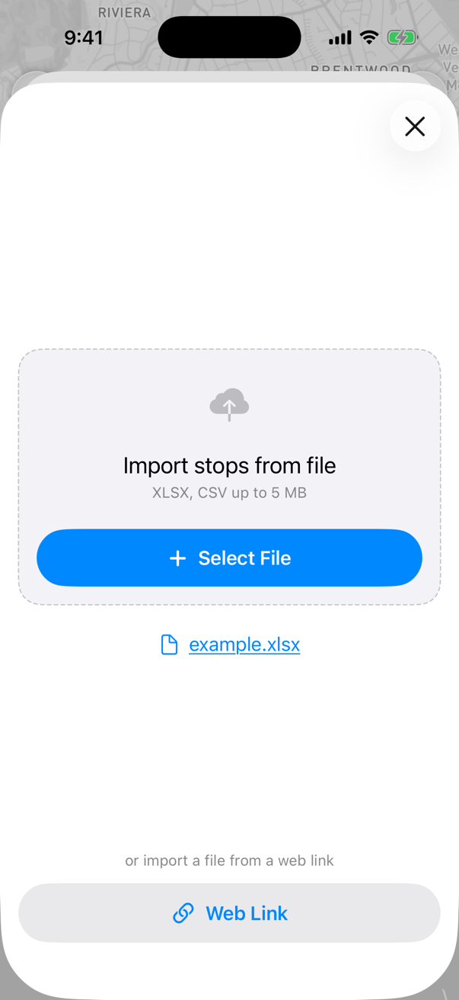
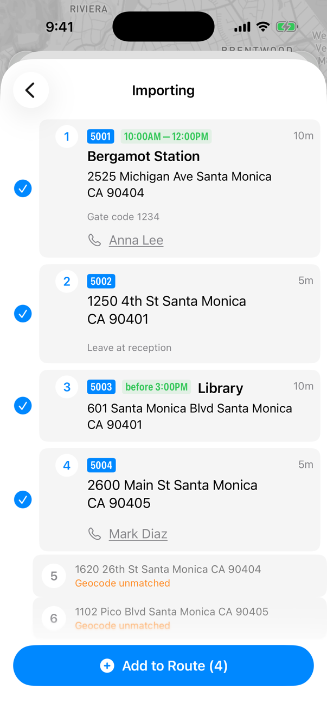

# Import from file and multi-line import


**Using MyWay on Android?** This page describes the iOS app version 3. See [Version 2 of this page](https://help.mywayroute.com/guides/import-from-file-and-multi-line-import).


Add many stops at once instead of one by one: paste a list of addresses (multi-line import), or import an .XLSX or .CSV file from your iPhone, from a web link or from [another app](#import-a-file-from-another-app).

<figure><figcaption>
Two ways to add stops to the route
</figcaption></figure>

To start, tap **Add Stop** (or the magnifier button in the top left corner of the map). Then tap the **List** tile for multi-line import or the **Import** tile to import a file.

If you import a file, make sure it uses the right format: see the [file example](import-from-file-and-multi-line-import.md#import-from-file-file-example). Processing can take a few minutes, as MyWay recognizes every address and matches it to the address database.

<figure><figcaption>
Multi-Line Import
</figcaption></figure> <figure><figcaption>
Import from file
</figcaption></figure> <figure><figcaption>
Import results
</figcaption></figure>

### Multiline import

1. Tap **List** to open Multi Search.
2. Type or paste up to 30 addresses, one address per line, and tap **Search**. MyWay tries to recognize each address.
3. Select the addresses you need (or tap **Select All**) and tap **Add to Route**.

Lines MyWay couldn't recognize can't be selected. Check the address and try again, or add that stop with the regular search.

### Import from file

1. Tap **Import**, then **Select File** and choose an .XLSX or .CSV file (up to 5 MB) on your iPhone. To use a file on the internet, tap **Web Link** instead and paste a link to an .XLSX or .CSV file.
2. Wait while MyWay processes the file. It then shows the recognized stops with their details (tracking ID, time window, time at stop, contact, notes). Rows MyWay couldn't find on the map are marked "Geocode unmatched" and can't be added.
3. Tap **Add to Route** to add the selected stops.

To see how the import file should look, download the file example ([example.xlsx](import-from-file-and-multi-line-import.md#import-from-file-file-example)). The order of columns doesn't matter: MyWay recognizes the columns by their titles and validates the data. If something doesn't go as expected, compare your file with the example to see the data formats we use.


The file needs to be on your iPhone first: send it from your computer by email, a messenger of your choice or AirDrop, or save it to the Files app.

If the file is already on your phone, you can also [open it from another app](#import-a-file-from-another-app).



If the app recognizes addresses wrong, suggesting another state or country, follow the advice in [this article](../i-cant-find-an-address.md#if-the-app-recognizes-addresses-wrong-suggest-another-state-or-country). MyWay finds the addresses from the file with the geocoder you chose in **Preferences**.


### Import a file from another app

If the file is already on your iPhone (for example, in Mail, Files or a messenger), send it to MyWay directly:

1. Open the file in that app and tap the Share button.
2. Choose MyWay in the list of apps. If you don't see it, swipe the row of apps to the end, tap **More** and find MyWay there.
3. MyWay opens the Import screen with this file and starts processing it.

This works with .XLSX and .CSV files.

### Import from file - file Example



Use the file above as an example of an .XLSX file you can import into MyWay Route Planner.


The order of columns doesn't matter, but the column titles and the format of the data do:

* Use English column titles, like in the example file. The address column can be called "address", "Full Address", "FullAddress", etc., but its content must be an address that geocoding services can recognize.
* Write time at stop as hours, minutes and seconds (00:10:00) or with units (10m, 1h30m). A plain number like 10 is read as seconds.
* Write times as 09:00, 15:00 or 3:00 PM.
* MyWay reads only the first sheet of an .XLSX file.

If you can, keep the column names exactly as in the example file to avoid processing issues.


<table data-full-width="false"><thead><tr><th>order number</th><th>name</th><th>address</th><th>latitude</th><th>longitude</th><th>duration</th><th>start time</th><th>end time</th><th>phone</th><th>contact</th><th>notes</th><th>color</th></tr></thead><tbody><tr><td>1020</td><td>Central Park</td><td>830 5th Ave, Central Park, New York</td><td></td><td></td><td>00:10:00</td><td>10:00 AM</td><td>15:00 PM</td><td>1234567890</td><td>John Dow</td><td></td><td></td></tr><tr><td>1022</td><td></td><td>350 5th Ave, Koreatown, New York</td><td></td><td></td><td>00:10:00</td><td></td><td>19:00 PM</td><td></td><td></td><td>Some notes</td><td></td></tr><tr><td>1023</td><td></td><td></td><td>40.6893</td><td>-74.0445</td><td></td><td></td><td></td><td></td><td></td><td></td><td></td></tr><tr><td>1024</td><td>Apple Store</td><td>103 Prince St, Soho, New York</td><td></td><td></td><td>00:25:00</td><td></td><td></td><td></td><td></td><td></td><td>red</td></tr></tbody></table>

**We recommend building your files from our example file to reduce possible errors.** A copy of the file is below:


