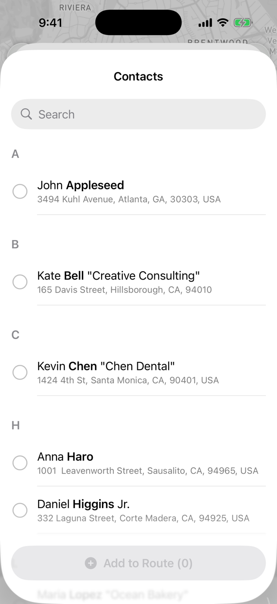
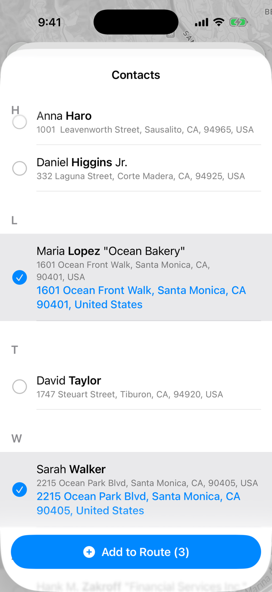
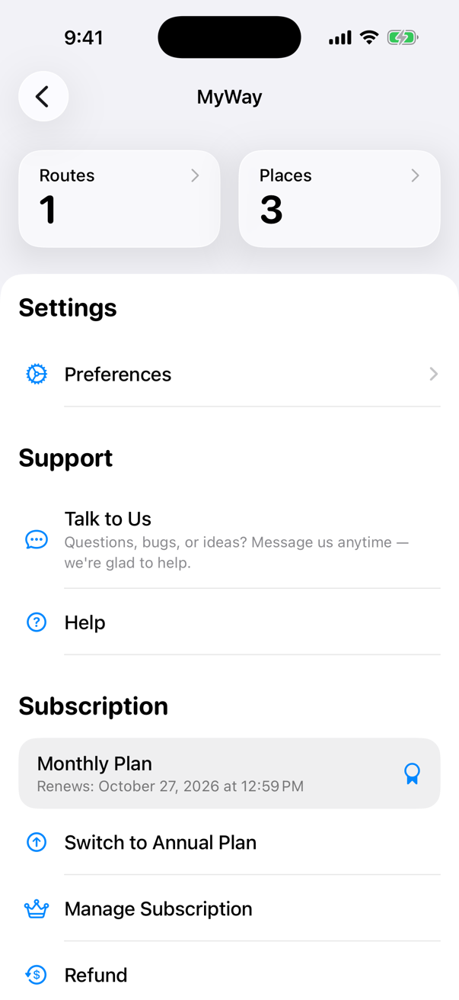
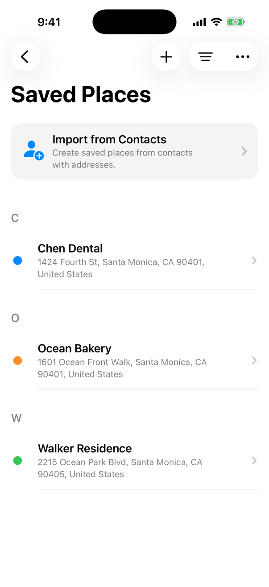
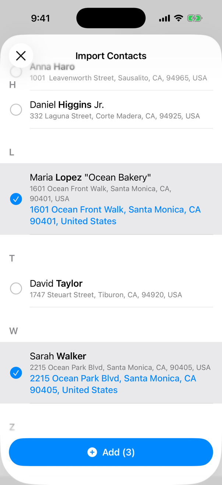
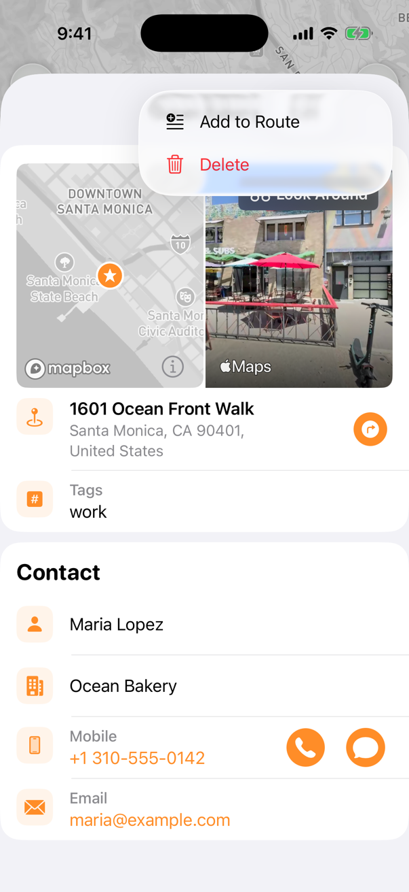
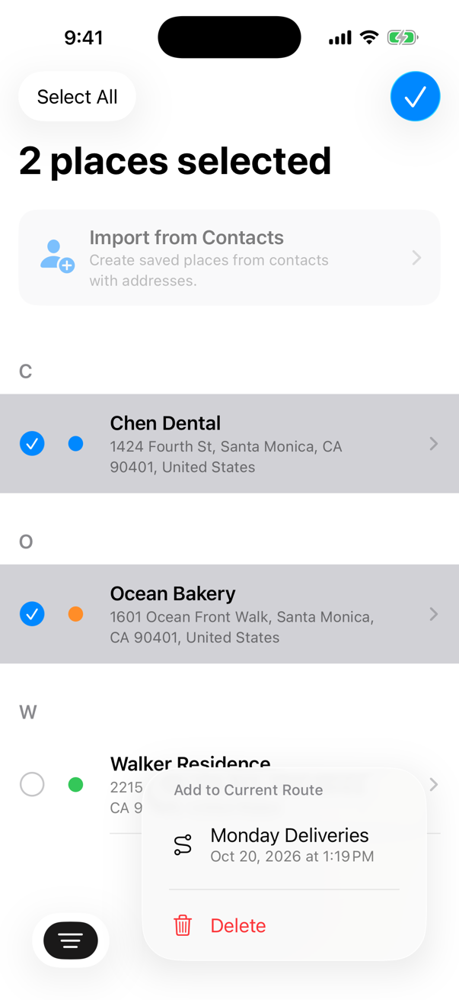
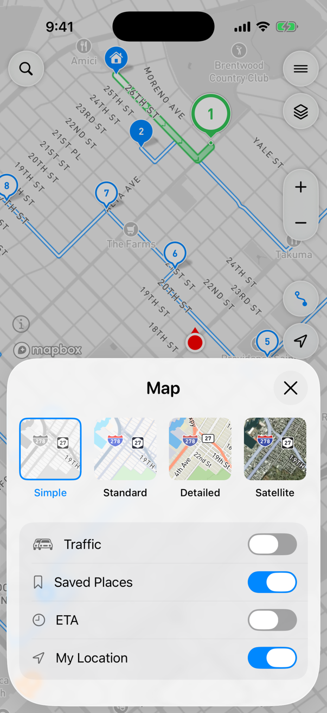
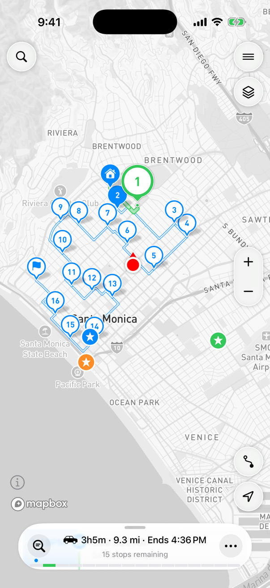

# Managing your Contacts and Places


**Using MyWay on Android?** This page describes the iOS app version 3. See [Version 2 of this page](https://help.mywayroute.com/guides/managing-your-contacts-and-places).


MyWay Route Planner has a lot of tools that can help you with often-visited places. That is especially valuable for businesses that go to the same places every now and then and want a simple and efficient way to repeat routes or build a new one in a few taps.

To help you build routes quicker, MyWay has two sources of stops besides the address search: Contacts and Places.

## Contacts

Contacts let you add addresses from your iPhone address book. If you give MyWay access to your contacts, it adds them to your route as stops together with their details: name, company, phone numbers and email. To open your contacts, tap **Add Stop** or the magnifier button in the top left corner of the map, and then tap **Contacts**.

<figure><figcaption></figcaption></figure>

Select one or several contacts and tap **Add to Route**. MyWay finds each contact's address and adds it as a stop. The contact details are saved in the stop's Contact section.

<figure><figcaption></figcaption></figure>

 

<figure><figcaption></figcaption></figure>


If MyWay can't find a contact's address, it asks you to set one: tap **Set Address**. If MyWay has no access to your contacts, tap **Open Settings** and allow access there. MyWay doesn't store your contacts on its servers.


## Places

Places work in a similar way, but there is much more in them than in Contacts. They are useful for sales reps, delivery drivers and everyone who needs a list of favorite places with their own settings and contact details, grouped by color, tags and so on.

First, build your list of places: open the menu (☰, top right) and tap **Places**. In Saved Places you can:

* create a new place: tap **+** (or **Add Place**);
* import places from your address book: tap **Import from Contacts**, select the contacts and tap **Add**. MyWay shows the address it found under each contact name, so you can check it before adding. The contact details are saved in the place's Contact section.

<figure><figcaption>
Menu
</figcaption></figure> <figure><figcaption>
Saved Places
</figcaption></figure> <figure><figcaption>
Import from Contacts
</figcaption></figure>

A place has the same settings as a stop: name, color, icon, notes, tags, time at stop, contact details and time window. To change them, open the place and tap **Edit**. When you add a place to a route, the stop gets these settings.

To find a place quickly, use the search at the bottom of Saved Places. The filter button shows places with certain colors and tags. In the **…** menu you can sort places by name, contact or address, and group them alphabetically, by color or by city.

### Add places to your route

There are several ways to add places to your route:

* **From the Add Stop screen**: tap **Places**, select one or several places and tap **Add to Route**, the same way as with Contacts.
* **From Saved Places**: open a place, tap **…** and choose **Add to Route**.
* **Several places at once**: in Saved Places, tap **…** > **Select** and select the places. For example, filter by your *work* tag first and tap **Select All**. Then tap **…** at the bottom and choose your current route under **Add to Current Route**.

<figure><figcaption>
Add a place to the route
</figcaption></figure> <figure><figcaption>
Add selected places
</figcaption></figure>

To see your places on the map, tap the layers button (top right, below the menu button) and turn on **Saved Places**. Tap a place on the map to open it.

<figure><figcaption>
Saved Places in the map layers
</figcaption></figure> <figure><figcaption>
Saved places on the map
</figcaption></figure>

### Stops and places

A stop can also become a saved place: open the stop and choose **Add to Saved Places**. A stop added from a place stays linked to it:

* **Update Saved Place** saves the stop's changes to the place;
* **Sync from Saved Place** copies the place's current settings to the stop;
* **Unlink Saved Place** removes the link.

You can still add stops one by one, from the map, or in any other way you like.
