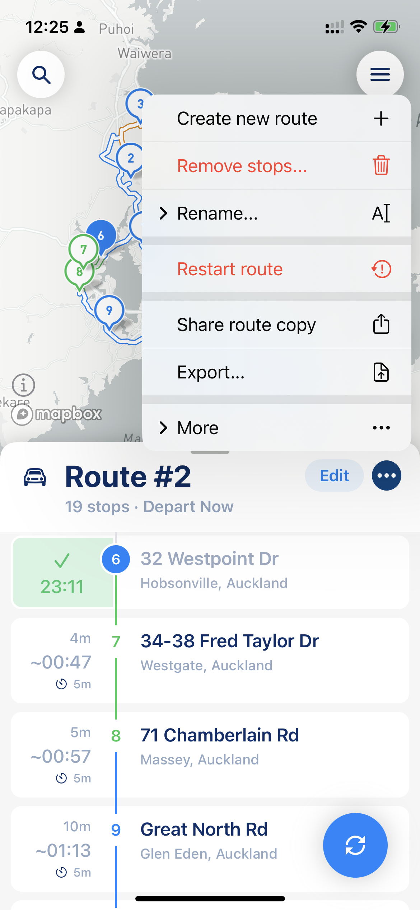
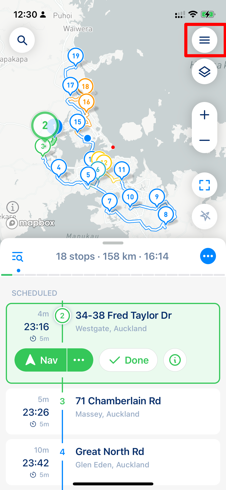
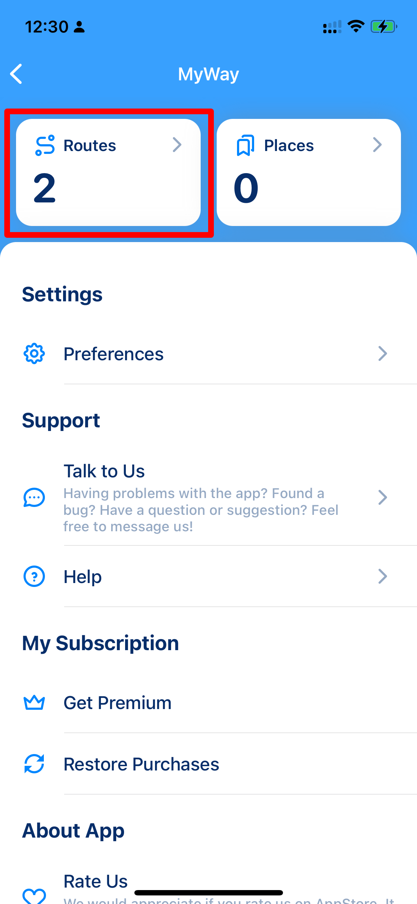
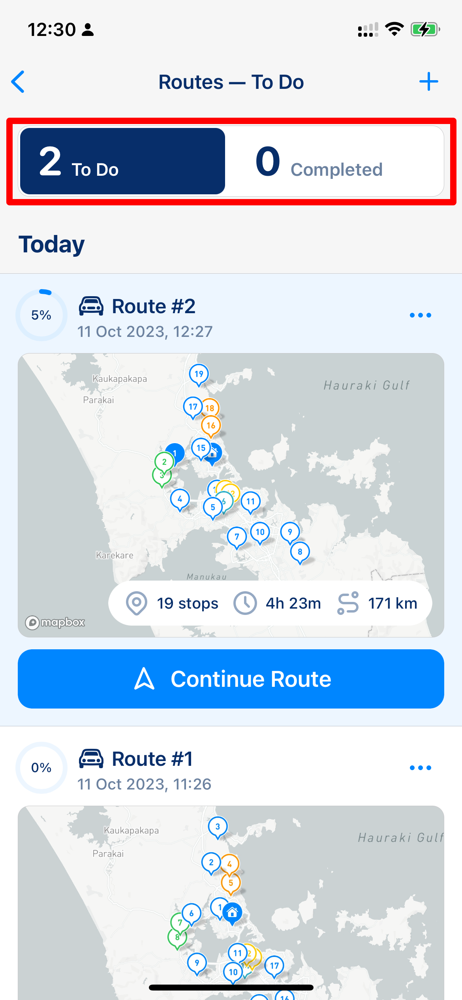
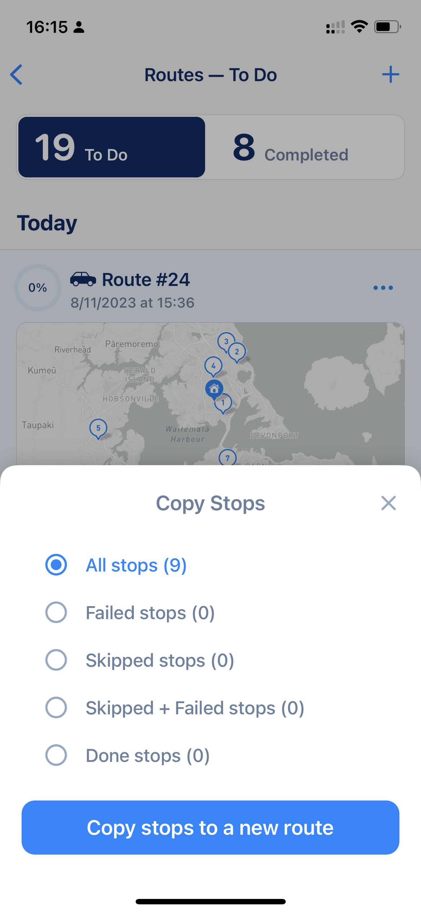

# Managing your Routes


**Using MyWay on Android?** This page describes the iOS app version 3. See [Version 2 of this page](https://help.mywayroute.com/guides/managing-your-routes).


MyWay Route Planner lets you create as many routes as you want. All routes are saved automatically after any change.

## How to create a new route?

Tap **…** in the route header (next to the route name) and choose **New Route**, or tap **+** in the Routes list.

<figure><figcaption>
Route menu on the main screen
</figcaption></figure>


Don't worry, you will not lose your current route or its history. The app saves the current route and all its data in the Routes list automatically.


The same **…** menu has **Export & Share**, to [export](export-your-route-and-share-it-with-others.md) the route or [share it with others](export-your-route-and-share-it-with-others.md#share-route-copy). The other items depend on the route status: for example, **Edit Route**, **Complete Route** and **Reoptimize Route** for a route in progress, and **Delete Stops…** for a route you're planning. Under **More** you'll find **Duplicate Route**, **Copy Stops…**, **Reverse Stop Order** and **Restart Route**.

To rename a route you're planning, tap the edit (pencil) button in the route header, then tap the route name. You can rename any route in the Routes list.

## Edit mode: select, delete and copy stops

Tap the edit (pencil) button in the route header to switch to edit mode. There you can:

* select stops: tap the circles next to them, or tap the select button at the bottom to select stops by status (Failed, Success), by group (Not Completed, Skipped), or all at once;
* delete the selected stops: tap the trash button;
* copy the selected stops to a new route: tap **…** at the bottom;
* change the order: touch and hold the handle on the right of a stop and drag it;
* rename the route: tap the route name.

Tap **Done** when you've finished. To delete stops without edit mode, tap **…** in the route header > **Delete Stops…** and choose **Delete All Stops** or **Delete Completed Stops**.

## Restart a route

To start a route over, tap **…** in the route header > **More** > **Restart Route**. This removes all statuses and proof of delivery and can't be undone. To run a completed route again without losing it, [duplicate it](#route-duplicate) instead.

## Where do you find all your routes?

All your routes are in the Routes list: open the menu (☰, top right) and tap **Routes**.

<figure><figcaption>
Main Window
</figcaption></figure> <figure><figcaption>
Menu
</figcaption></figure> <figure><figcaption>
Routes
</figcaption></figure>

Routes are grouped by date. Each route shows its progress, a map preview, the number of stops, the distance and the time. To go back to the route you're following, tap **Continue Route**.

* To show only some routes, tap **Routes** at the top and choose All, Scheduled or Completed.
* To show routes for a period, tap the calendar button and choose a date range, for example This Week or Last 30 Days.

Each route in the list has its own **…** menu: **Rename**, **Duplicate**, **Copy Stops**, **Report** (to [download a route report](export-your-route-and-share-it-with-others.md#files-export)) and **Delete Route**.

<figure><figcaption>
Route menu in the Routes list
</figcaption></figure>


Your routes are saved on your device. MyWay sends route data to our servers only when a feature needs it, for example to optimize a route or to create a link to share it. To learn more about how we handle your data, see [this article](../faq/your-privacy-and-where-we-store-your-data.md).


## Duplicate route and Copy Stops

### Route Duplicate

You can make a complete copy of a route: in the Routes list, tap **…** next to the route and choose **Duplicate**. The copy keeps the stops and route settings (like the vehicle type and start location), but not the progress, and it becomes your active route.

### Copy Stops

**Copy Stops** moves some stops from a route to a new one. Choose which stops to copy (All, Failed, Incomplete, Failed + Incomplete or Completed), then tap **Copy to New Route**. The stops are copied with their settings.

<figure><figcaption>
Copy Stops options
</figcaption></figure>


**Pro tip:** complete your routes even if some stops are unfinished. The route summary then shows the **Copy Stops to New Route** button. Choose Failed + Incomplete there, and you get a new route with the missed stops in one tap.


## Complete your route

You can complete a route in two ways: tap **Complete Route** at the end of the stop list, or tap **…** in the route header and choose **Complete Route**. If some stops are still unfinished, MyWay tells you how many and asks you to confirm with **Complete Route Anyway**.
