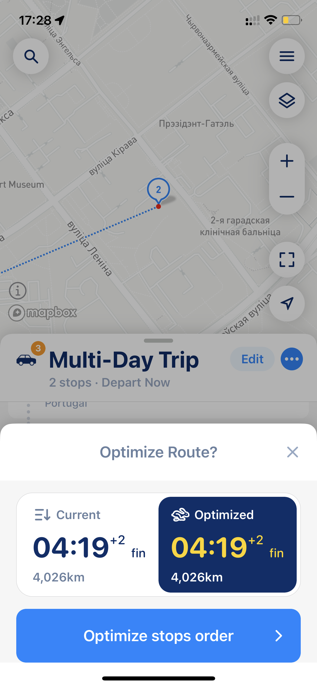
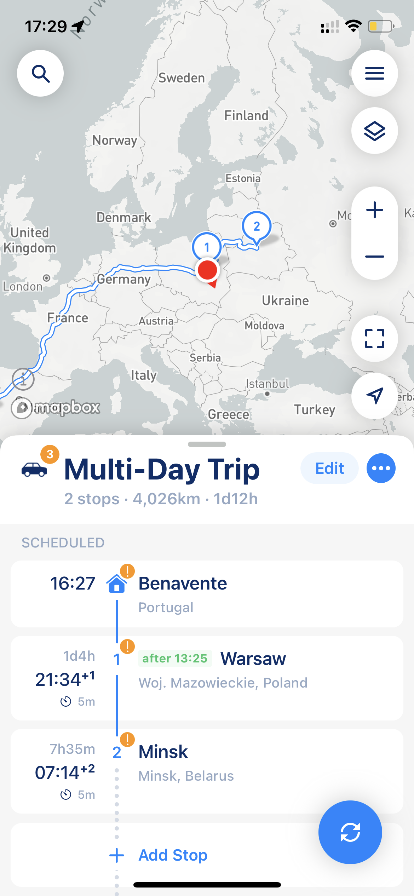

# Planning Multi-Day routes


**Using MyWay on Android?** This page describes the iOS app version 3. See [Version 2 of this page](https://help.mywayroute.com/guides/planning-multi-day-routes).


MyWay Route Planner, like no other app on the market, supports multi-day routes, road trips and travel, and has many settings that help you build, follow and understand such routes better.

<figure><figcaption>
Multi-Day Optimization
</figcaption></figure>

 

<figure><figcaption>
Multi-Day Trip
</figcaption></figure>

When you plan a multi-day route, there are a few things to keep in mind.

A small "+1" (or "+2", etc.) next to a time in the stop list means this time falls on the next day (or later) after the route start. It's very similar to what you see when you buy plane tickets.

To plan when the route starts, set the departure time ("Depart at…") under [Route Settings](how-to-use-myway-route-planner.md#route-settings).

### Time zones

Almost all route planner apps on the market show the time and ETAs of all stops in your local time zone. This makes their routes inaccurate if you drive through time zone changes or set time windows for locations in different time zones. MyWay, on the other hand, knows the time zone of each stop you add and applies it to time windows and ETAs, similar to how airlines show arrival times in the destination time zone. If a stop's time zone differs from your iPhone's time zone, you see the time zone next to the time (like GMT+2).

### Time windows

A [time window](understanding-stop-settings.md#time-windows) has no date, only a period From–To. MyWay places it on the right day relative to the route start (your departure time):

* **If the window ends before the route starts**, MyWay moves the whole window to the next day.
* **If To is earlier than From** (for example, from 10 PM to 2 AM), it's an overnight window that ends the next day.
* **Only From**: you arrive at the stop any time after this time, starting from the day the route starts.
* **Only To**: you arrive at the stop before the nearest such time after the route start.


If your route starts at 10 AM and a stop's time window is from 4 AM to 6 AM, the window ends before the route starts, so MyWay places it on the next day: from 4 AM to 6 AM tomorrow.

If your route starts at 10 AM and the time window is from 2 AM to 9 AM, it also ends before the route starts, so MyWay moves it to the next day as well.

