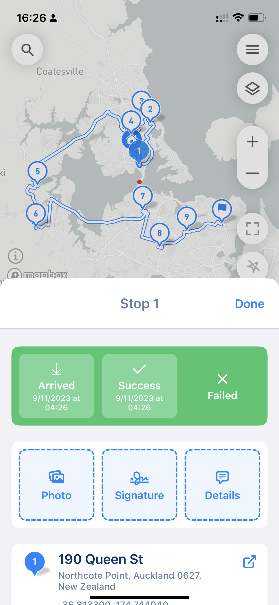
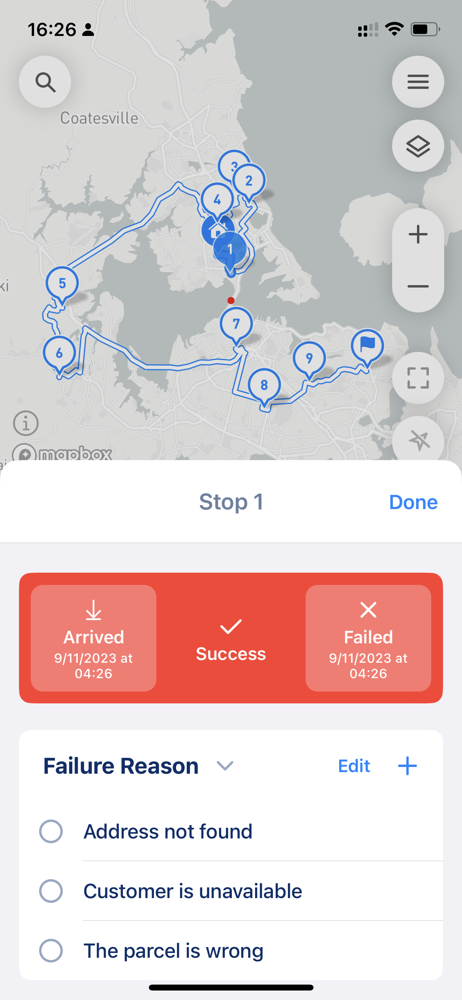
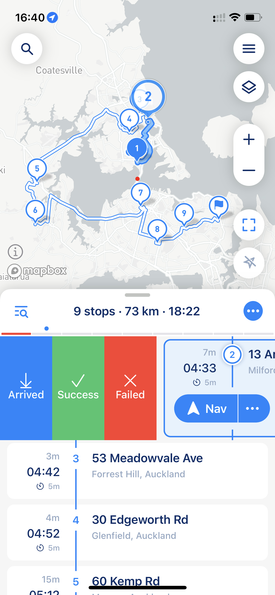

# Proof of Delivery


**Using MyWay on Android?** This page describes the iOS app version 3. See [Version 2 of this page](https://help.mywayroute.com/guides/proof-of-delivery).


The app provides several features for managing stops when you are on a route, such as setting statuses, taking photos, adding notes, collecting signatures, and more. These features depend on the "Proof of Delivery" setting.

### Turn Proof of Delivery on or off

Tap the menu button (three lines, top right corner of the map) > Preferences > "Proof of Delivery". The first time you complete a stop, MyWay also asks "Turn On Proof of Delivery?".

### Behavior of the "Done" Button

The buttons on the current stop in route-following mode change based on the "Proof of Delivery" setting:

• **When "Proof of Delivery" is ON:** you see "Success" and a "Failed" (✕) button. Each of them opens the Proof of Delivery screen.

• **When "Proof of Delivery" is OFF:** the "Done" button closes the current stop and activates the next one.

### Proof of Delivery Features

The Proof of Delivery screen has three statuses, each with the time it was set:

• **Arrived:** you arrived at the stop. It is selected automatically when you mark the stop as "Success".

• **Success:** the stop is completed. You can add proof: photos, a signature, and details.

• **Failed:** the stop can't be completed. Choose a failure reason or add a "Custom Reason". You can also add photos, a signature and details.

Proof can include:

• **Photo:** up to 5 photos, taken with the camera or chosen from your library.

• **Signature:** the customer signs on the screen.

• **Details:** a text note.

Tap "Done" to save the proof and close the stop.

<figure><figcaption>
only Arrived status in set
</figcaption></figure> <figure><figcaption>
Arrived and Success
</figcaption></figure> <figure><figcaption>
Arrived and Failed
</figcaption></figure>

### Failure Reasons

MyWay has three default failure reasons: "Address not found", "Customer unavailable" and "Parcel is wrong". To change the list, go to Preferences > "Failure Reasons" (or tap "Edit" next to "Failure Reason" on the Proof of Delivery screen). Add the reasons you run into most often to mark failures faster.

### Quick statuses

You can quickly set a status from route-following mode by swiping a stop to the right and picking "Arrived", "Success" or "Failed" (see screenshot below). The same options are available when you touch and hold a stop.

<figure><figcaption>
Proof of Delivery status by swipe
</figcaption></figure>

### Change proof later

To change the status or proof of a completed stop, open the stop details. The proof is included in the [PDF report](export-your-route-and-share-it-with-others.md#files-export). Proof files are kept on your iPhone; you can see how much space they take in Preferences > "Route Files".


When you complete a route, MyWay deletes the proof of stops that are still unfinished.

