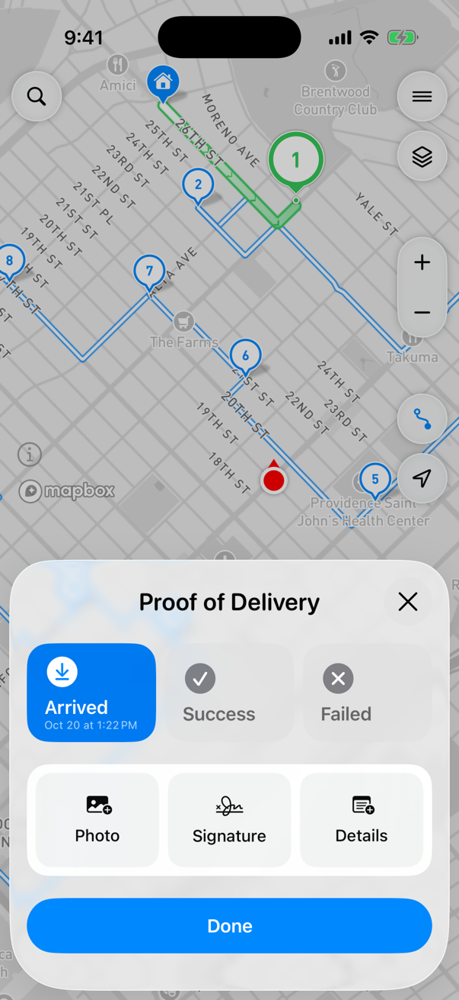
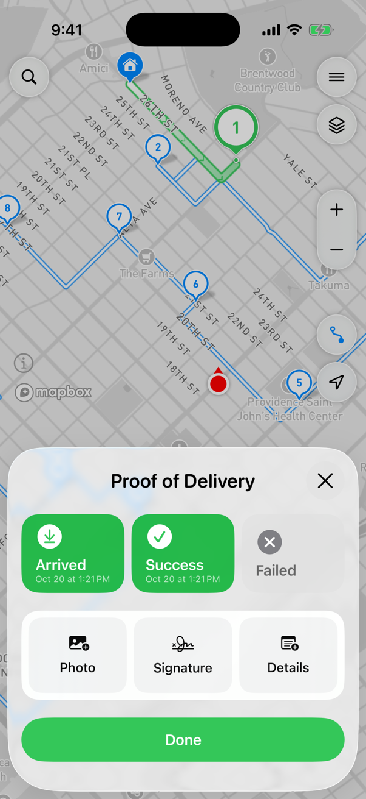
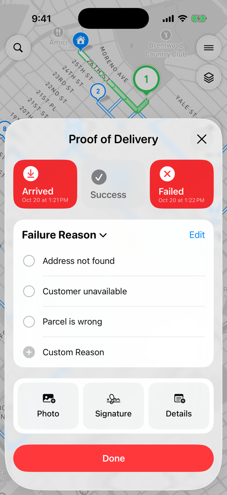
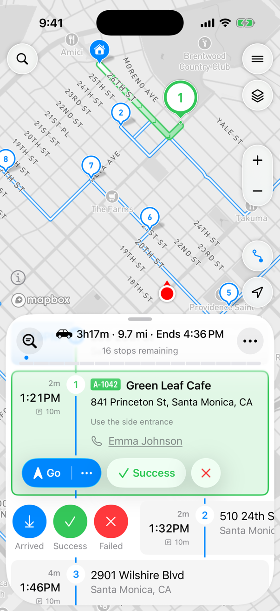

# Proof of Delivery


**Using MyWay on Android?** This page describes the iOS app version 3. See [Version 2 of this page](https://help.mywayroute.com/guides/proof-of-delivery).


Proof of Delivery lets you record what happened at each stop while you're on a route: set a status, take photos, collect a signature and add notes. These features work when the Proof of Delivery setting is on.

## Turn Proof of Delivery on or off

Open the menu (☰, top right) and tap **Preferences** > **Proof of Delivery**. The first time you complete a stop, MyWay also asks "Turn On Proof of Delivery?".

## Complete a stop

The buttons on the current stop depend on the Proof of Delivery setting:

* **Proof of Delivery on:** you see **Success** and **Failed** (✕). Each of them opens the Proof of Delivery screen.
* **Proof of Delivery off:** **Done** closes the current stop and makes the next one current.

## Statuses and proof

The Proof of Delivery screen has three statuses, each saved with the time you set it:

* **Arrived:** you arrived at the stop. MyWay selects it automatically when you mark the stop as **Success**.
* **Success:** the stop is completed. You can add proof: photos, a signature and details.
* **Failed:** the stop can't be completed. Choose a failure reason or add a **Custom Reason**. You can add photos, a signature and details here too.

Proof can include:

* **Photo:** up to 5 photos, taken with the camera or chosen from your library.
* **Signature:** the customer signs on the screen.
* **Details:** a text note.

Tap **Done** to save the proof and close the stop.

<figure><figcaption>
Arrived
</figcaption></figure> <figure><figcaption>
Arrived and Success
</figcaption></figure> <figure><figcaption>
Arrived and Failed
</figcaption></figure>

## Failure reasons

MyWay comes with three failure reasons: "Address not found", "Customer unavailable" and "Parcel is wrong". Add the reasons you run into most often to mark failures faster: go to **Preferences** > **Failure Reasons**, or tap **Edit** next to Failure Reason on the Proof of Delivery screen.

## Quick statuses

To set a status faster, swipe a stop to the right in route-following mode and pick **Arrived**, **Success** or **Failed** (see the screenshot below). The same options appear when you touch and hold a stop.

<figure><figcaption>
Proof of Delivery status by swipe
</figcaption></figure>

## Change proof later

To change the status or proof of a completed stop, open the stop details. The proof is included in the [PDF report](export-your-route-and-share-it-with-others.md#files-export).

Proof files are kept on your iPhone. To see how much space they take, go to **Preferences** > **Cache** > **Route Files**. Clearing the cache doesn't delete them.


When you complete a route, MyWay deletes the proof of stops that are still unfinished.

