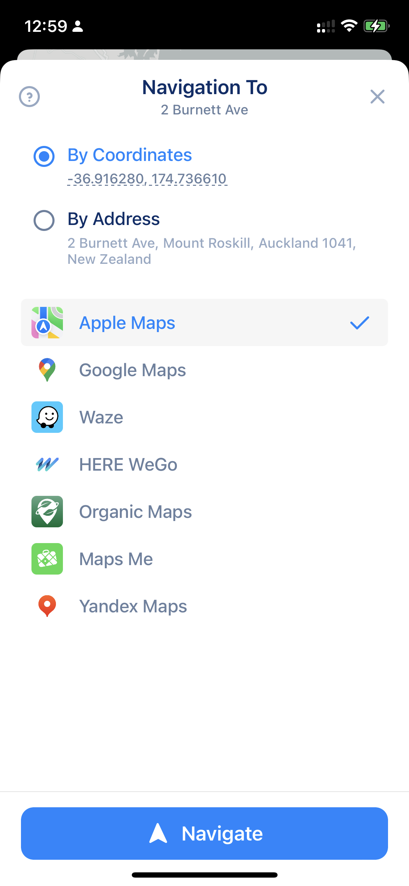
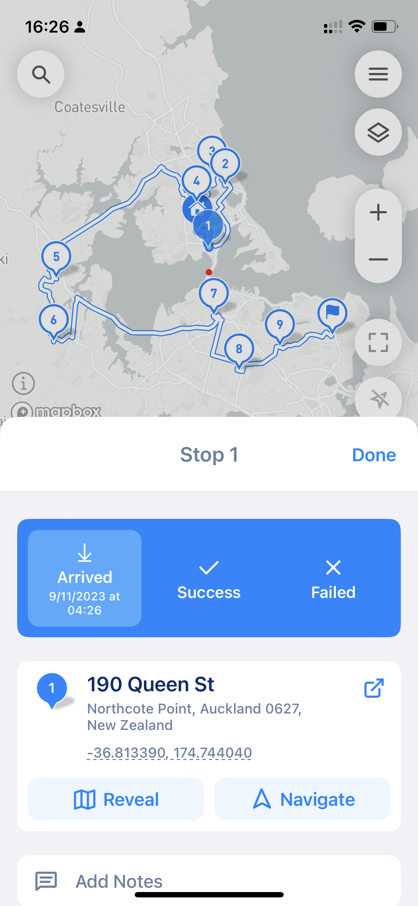

# Understand Navigation Settings


**Using MyWay on Android?** This page describes the iOS app version 3. See [Version 2 of this page](https://help.mywayroute.com/guides/understand-navigation-settings).


## How to pass the address to Navigation App

MyWay supports many navigation apps like Apple Maps, Google Maps, Waze, Organic Maps, HERE WeGo, etc.

To pass a stop to a navigation app, build your route and start it. The current stop has a "Go" button with an arrow icon. That button passes the stop to the navigation app, so you can navigate to the stop location using your favorite navigation app.

<figure><figcaption>
Go button
</figcaption></figure>

Tap "…" next to "Go" (or touch and hold a stop and choose "Navigate") to open "Navigation to Stop". There you can:

* choose how to navigate: "By GPS Coordinates" or "By Address" (see [below](#navigation-types-coordinates-or-address));
* choose the navigation app;
* tap "Navigate to Stop" to navigate to this stop;
* tap "Navigate through" to pass several stops at once (see [below](#navigate-through-several-stops)).

### Navigate through several stops

Apple Maps and Google Maps can take up to 10 of your remaining stops at once. In "Navigation to Stop", the "Navigate through" button shows the numbers of the first and the last stop that will be passed. Other navigation apps take one stop at a time; for them, MyWay doesn't show this button.


A navigation app builds its own route through these stops. It doesn't know your time windows, priorities or [road restrictions](how-to-use-myway-route-planner.md#road-restrictions), so check that it follows the order you planned.


## Navigation Apps

Currently, MyWay supports Apple Maps, Google Maps, Waze, HERE WeGo, Organic Maps, MAPS.ME, Yandex Maps and Sygic. This is more navigation app integrations than most route planners on the market.

To choose your default navigation app, tap the menu button (three lines, top right corner of the map) > Preferences > "Navigation App". Apps that are not installed on your iPhone have a download button that opens the App Store. If the app you chose is removed from your iPhone, MyWay opens Apple Maps instead.

There are hundreds of navigation apps worldwide, and it's not possible to support every single one directly. If you prefer a different app, open "Navigation to Stop" and tap the coordinates under "By GPS Coordinates" to copy them. You can then paste them into any navigation app of your choice. This way, you can use virtually any navigation app with MyWay.

<figure><figcaption>
Navigation to Stop
</figcaption></figure>

## Navigation types: Coordinates or Address

MyWay supports two navigation types: navigation by GPS coordinates and navigation by address. This setting determines what data MyWay passes to your navigation app and affects navigation accuracy.

You can change it for a stop in "Navigation to Stop", or set the default in the menu (three lines, top right corner of the map) > Preferences > "Navigation Precision". In the same "Navigation" section you can also choose the "Distance Unit" (miles or kilometers).

### **Navigation by GPS coordinates**

Navigation by GPS coordinates is the default and is usually more precise. In this case, MyWay passes the stop's GPS coordinates to the navigation app as the destination.


Navigation by GPS coordinates is usually more precise. However, navigation by address might be more accurate if your stop is in a high-density area.


### **Navigation by Address**

Navigation by address can be less accurate because MyWay passes the stop's address to the navigation app, and the navigation app tries to find this address in its own database. This type might be more accurate if your stop is in a high-density area or your navigation app can't build a route to your stop. If the address does not contain a house number, MyWay passes the coordinates instead.


Organic Maps, MAPS.ME, Yandex Maps and Sygic always navigate by coordinates. Waze searches for the address near the stop's coordinates.\
\
Also, some navigation apps search for the address near your location, so they might find a very similar address that is closer to you. In some cases, it might send you to the wrong address. It's infrequent, but we feel like you need to know.


## Live Activity

While you are on a route, MyWay shows the current stop on the Lock Screen and in the Dynamic Island: its address, arrival time and buttons to complete it, and "Call" if the stop has a phone number. "Done" closes the stop right from the Lock Screen. With [Proof of Delivery](proof-of-delivery.md) on, you see "Success" and "Failed" instead; they open MyWay so you can add the proof.

You can manage it in the menu (three lines, top right corner of the map) > Preferences > "Live Activity":

* **Show Live Activity**: turns the Live Activity on or off.
* **Auto-Navigate to Next Stop**: when you complete a stop from the Live Activity, directions to the next one open in your navigation app.


Live Activity is available on iPhone. If you don't see it, check that Live Activities for MyWay are turned on in iOS Settings > MyWay.


## Show on Map

MyWay can also open a stop in your navigation app without starting navigation. It's handy when you want to see the place, a photo of your destination or "Street View". Open the stop details and tap the round button next to the address ("Show on Map"). Touch and hold this button to choose another app just this time.

<figure><figcaption>
Show on Map
</figcaption></figure>
