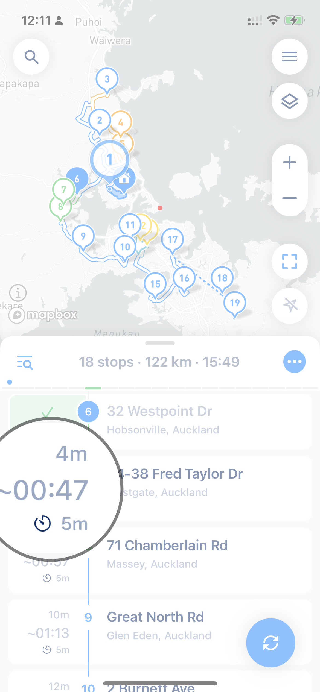
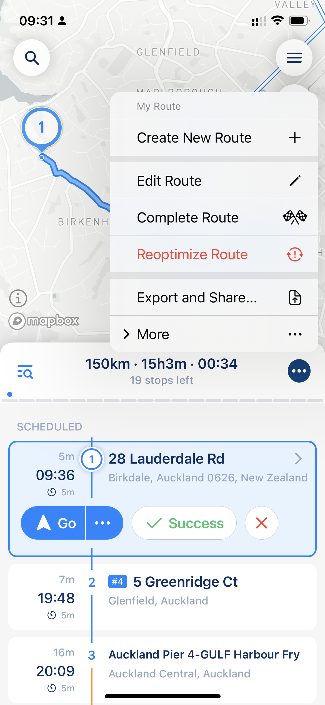

# Understand Optimisation Settings


**Using MyWay on Android?** This page describes the iOS app version 3. See [Version 2 of this page](https://help.mywayroute.com/guides/understand-optimisation-settings).


MyWay Route Planner lets you keep your own stop order or optimize it. You can build a route exactly the way you want it (without optimization, in your own order), or let MyWay reorder the stops to give you the fastest or shortest route. Below we explain both options and how to update a route that is already in progress.

## Optimize/Reoptimize Route settings

When you build a route, MyWay shows "Optimize Route" with two versions of your route:

**"Current"** keeps the stop order exactly as you entered it. You can build a route precisely the way you want it and track your route or delivery progress with MyWay. To use it, tap "Current" and then "Keep Stop Order".

**"Optimized"** gives you the most optimal route from a time and travel distance perspective. This option is preferable as it **will help you to save time and money on fuel.** To use it, tap "Optimized" and then "Optimize Stop Order".

Each version shows the time you will be done by and the distance, so you can compare them before you choose.

<figure><figcaption>
Optimize Route
</figcaption></figure>


You can also combine both: optimize the route first, then edit it to your liking (move stops, add new stops) and choose "Keep Stop Order" to keep your changes. Once the route is in progress, use ["Update Route"](understand-optimisation-settings.md#route-update-and-reoptimize) to actualize the ETAs.


## Route Update and Reoptimize

In some cases, your route needs to be updated or reoptimized. Some reasons why it might be required or good to do:

* you added some stops after you started your route
* you did not close stops in the order suggested by the app
* you want to update the time estimation (ETAs)
* you decided to take a short break, and now the time in your stops does not look correct
* you changed your stops' order and want to actualize your route, etc.

A good sign you might need a route update is the "\~" symbol next to the time. It means that this time is approximate only. For example, MyWay shows it after a stop you closed out of order.

<figure><figcaption>
Approximate time
</figcaption></figure>

To update a route in progress, tap the "…" button in the route header and choose "Reoptimize Route". MyWay asks "How to reoptimize?" and offers two options:

* **"Update Route"**: refresh the route and ETAs, keep the stop order.
* **"Reoptimize Route"**: reorder all stops to build the optimal route.

When the route paths are out of date, the round blue button with arrows also appears at the bottom right. Tapping it opens the same choice with "Update Route" selected.

If you pick another stop as the next one, MyWay asks "Reoptimize remaining stops?" Choose "Reoptimize Route" to keep the time and distance accurate, or "No, thanks" to keep your order.

<figure><figcaption>
Reoptimize Route in the route menu
</figcaption></figure>

### **Difference between "Update Route" and "Reoptimize Route"**

**"Update Route" does not change your stop order but actualizes the route and ETAs.** Completed stops stay in the "Scheduled" section, in their places, and MyWay considers them when it builds the new route, so they might affect the overall route time and distance. A stop you closed out of order also stays in its place, and the route goes through it. **In this case, the route will not be optimal, but your order will be kept.**

**"Reoptimize Route" rebuilds the whole route based on your preferences and gives you an optimal route, considering all changes you have made so far (like newly added stops, finished stops, etc.)** MyWay shows you the [Optimize Route options](understand-optimisation-settings.md#optimize-reoptimize-route-settings) again. In this case, the app moves all completed stops to the "Finished" section and excludes them from the route. All distances and completion times are saved, so you will not lose data. **As a result of reoptimization, you will get the most optimal route.**


If you closed some stops out of order, "Update Route" keeps them in place. To rebuild the rest of the route around them, use "Reoptimize Route".


### Starting location

This setting is not visible in the app but has two options:

* When "My Location" is turned on in the map layers, your current location and time are taken as a temporary starting point when you update or reoptimize your route.
* When "My Location" is turned off in the map layers, the last finished stop is used as the starting point, and the starting time is that stop's completion time.

<figure><figcaption>
My Location in the map layers
</figcaption></figure>


**Turning "My Location" off is not recommended**, as it might affect route distance and time estimation accuracy. **It might be helpful if there is no access to your current location or if your current location will break the route** (for example, you are far away from your stops, in another country, on an island, etc.). Still, we don't recommend using it to block app access to your location data on a permanent basis.


## Route Reverse (Reverse Stop Order)

MyWay also supports route reverse when you need to flip the route (for example, you have only the start location and want to start collecting parcels from the farthest stop, coming back to start). This might be useful when your route is narrow and lies in one direction (like a directional sector).

To flip your route, tap the "…" button in the route header > More > "Reverse Stop Order". The order of stops is reversed, except priority stops; the start and end locations stay in place. Then build the route and choose "Current" ("Keep Stop Order") to keep the reversed order.

If the route is already in progress, MyWay warns you that you'll have to start the route again and choose "Current" to keep the new order.


Please keep in mind that the "Current" order ignores stop time windows, priority and other stop settings that are taken into account when you choose "Optimized". A reversed route keeps priority stops in place but ignores time windows. "Current" and reverse are for users who prefer to follow their own routes. You can still optimize the route, then edit it to your taste and choose "Current" afterward to make a combo between optimized and current.

