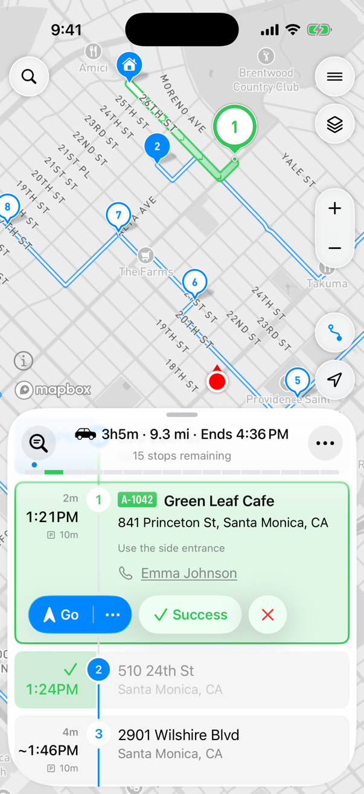
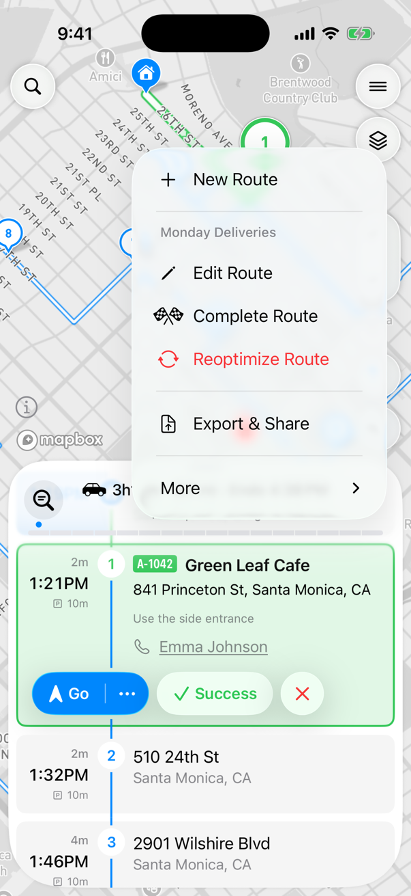
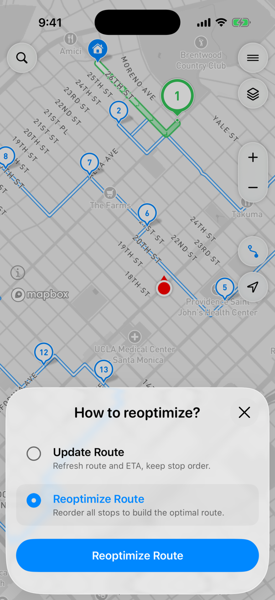
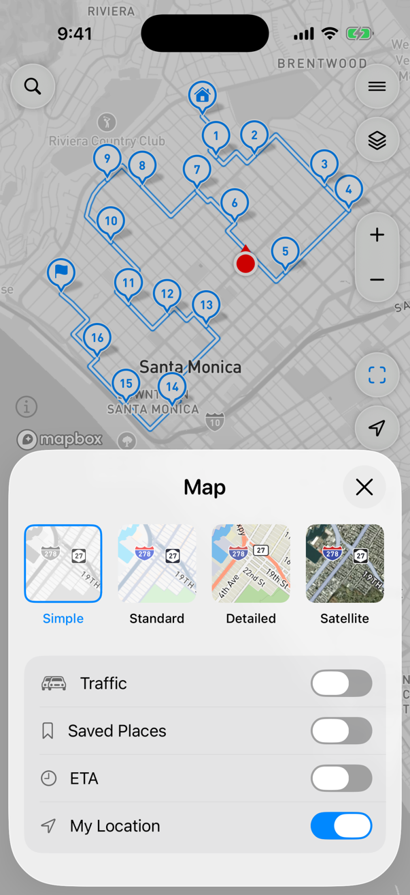

# Understand Optimisation Settings


**Using MyWay on Android?** This page describes the iOS app version 3. See [Version 2 of this page](https://help.mywayroute.com/v2/guides/understand-optimisation-settings).


You can build a route exactly the way you want it, in your own order, or let MyWay reorder the stops to give you the fastest or shortest route. Once you're on the road, you can update the route or reoptimize the stops that are left.

## Optimize/Reoptimize Route settings

When you build a route, MyWay shows two versions of it:

**Current** keeps the stop order exactly as you entered it. You can build a route precisely the way you want it and track your route or delivery progress with MyWay. To use it, tap **Current** and then **Keep Stop Order**.

**Optimized** gives you the most optimal route in terms of time and travel distance. This option is preferable, as it **will help you save time and money on fuel.** To use it, tap **Optimized** and then **Optimize Stop Order**.

Each version shows the time you'll be done by and the distance, so you can compare them before you choose.

<figure><figcaption>
Optimize Route
</figcaption></figure>


You can also combine both: optimize the route first, then edit it to your liking (move stops, add new ones) and choose **Keep Stop Order** to keep your changes. Once the route is in progress, use [Update Route](understand-optimisation-settings.md#route-update-and-reoptimize) to actualize the ETAs.


## Route Update and Reoptimize

Sometimes your route needs an update or a reoptimization. For example, when:

* you added stops after you started the route;
* you didn't complete stops in the order the app suggested;
* you want to update the time estimates (ETAs);
* you took a short break, and the times at your stops no longer look right;
* you changed the stop order and want to actualize the route.

A good sign that you need a route update is the "\~" symbol next to a time. It means the time is approximate, for example after a stop you completed out of order.

<figure><figcaption>
Approximate time
</figcaption></figure>

To update a route in progress:

1. Tap **…** in the route header and choose **Reoptimize Route**.
2. MyWay asks how to reoptimize. Choose **Update Route** to refresh the route and ETAs and keep the stop order, or **Reoptimize Route** to reorder all stops and build the optimal route.

When the route paths are out of date, the round blue button with arrows also appears at the bottom right. It opens the same choice, with **Update Route** selected.

If you pick another stop as the next one, MyWay asks "Reoptimize remaining stops?". Choose **Reoptimize Route** to keep the time and distance accurate, or **No, thanks** to keep your order.

<figure><figcaption>
Reoptimize Route in the route menu
</figcaption></figure> <figure><figcaption>
Update or reoptimize
</figcaption></figure>

### Difference between Update Route and Reoptimize Route

**Update Route doesn't change your stop order, but it actualizes the route and ETAs.** Completed stops stay in the Scheduled section, in their places, and MyWay considers them when it builds the new route, so they might affect the overall route time and distance. A stop you completed out of order also stays in its place, and the route goes through it. **In this case, the route won't be optimal, but your order will be kept.**

**Reoptimize Route rebuilds the whole route based on your preferences and gives you an optimal route, considering all the changes you've made so far (like newly added stops or finished stops).** MyWay shows you the [two versions of the route](understand-optimisation-settings.md#optimize-reoptimize-route-settings) again. Completed stops move to the Finished section and are excluded from the route. All distances and completion times are saved, so you won't lose any data. **As a result of reoptimization, you get the most optimal route.**


If you completed some stops out of order, Update Route keeps them in place. To rebuild the rest of the route around them, use Reoptimize Route.


### Starting location

There is no separate setting for where an updated route starts. It depends on **My Location** in the map layers:

* **My Location on**: your current location and time are the temporary starting point when you update or reoptimize your route.
* **My Location off**: the last finished stop is the starting point, and the starting time is that stop's completion time.

<figure><figcaption>
My Location in the map layers
</figcaption></figure>


**We don't recommend turning My Location off**, as it might affect the accuracy of route distance and time estimates. **It can help if MyWay has no access to your current location or if your current location would break the route** (for example, you are far away from your stops, in another country or on an island). Still, we don't recommend using it to block the app's access to your location permanently.


## Route Reverse (Reverse Stop Order)

MyWay can also flip your route. For example, you have only a start location and want to start collecting parcels from the farthest stop, coming back to the start. This might be useful when your route is narrow and lies in one direction (like a directional sector).

1. Tap **…** in the route header > **More** > **Reverse Stop Order**. The stops are reversed, except priority stops; the start and end locations stay in place.
2. Build the route and choose **Current** (**Keep Stop Order**) to keep the reversed order.

If the route is already in progress, MyWay warns you that you'll have to start it again.


Keep in mind that the Current order ignores time windows, priority and the other stop settings that are taken into account when you choose Optimized. A reversed route keeps priority stops in place but ignores time windows. Current and reverse are for users who prefer to follow their own routes. You can still optimize the route, then edit it to your taste and choose Current afterward to combine both.

