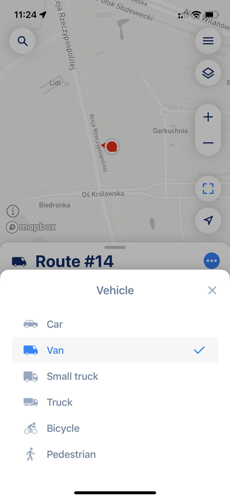

# Understand Vehicle Settings


**Using MyWay on Android?** This page describes the iOS app version 3. See [Version 2 of this page](https://help.mywayroute.com/guides/understand-vehicle-settings).


Selecting the right vehicle type is essential for planning your stops well. We offer several vehicle options, each designed for specific purposes and with its own parameters. Below are the differences between them, to help you choose.


To choose the vehicle, tap the vehicle button (for example, **Car**) under Route Settings, below your stop list, while you plan your route. To set the default vehicle for new routes, tap the first button in that row and change **Vehicle** there.


<figure><figcaption></figcaption></figure>

For most users, **Car** and **Van** are the main options and cover 95% of their needs. We recommend **Small Truck** and **Truck** only when your vehicle is very high or long and you want MyWay to take truck restrictions into account.


The vehicle type affects the route time and distance: a car route is different from a small truck route, and both are different from a truck route. Each vehicle type has its own weights, designed to make the route more convenient for the driver. [Make sure you use the right settings](../faq/the-route-myway-produced-doesnt-look-correct.md) to get the best results for your needs.

If you drive a van or a truck, the optimization algorithm tries to avoid small roads and penalizes intersections. It also knows which areas are not allowed for trucks (like tunnels, low bridges or restricted roads) and avoids them, so your route may look longer, but it will suit your vehicle.


## Stop limits

The vehicle type also sets the maximum number of stops in a route (completed and skipped stops count, the start and end locations don't):

* Car and Van: up to 200 stops
* Small Truck and Truck: up to 150 stops
* Bicycle and Pedestrian: up to 50 stops

If your route has more stops, MyWay shows the "Too many stops" message when you build the route. Split the route or choose another vehicle type.

## Vehicle options

### Car

* **Dimension:** Height = 1.9 meters (6 ft), Width = 1.6 meters (5 ft)
* **Weight:** Up to 3500 kg (7700 lbs)

**Description:** Car is the default vehicle type. It suits most passenger cars and small delivery vehicles.

### Van

* **Dimension:** Height = 2.2 meters (7.2 ft), Width = 2.0 meters (6.6 ft)
* **Weight:** Up to 3500 kg (7700 lbs)

**Description:** For larger vehicles that carry loads up to 3,500 kg, with a slightly reduced speed factor (90%). Van tends to favor highways and higher-class roads, such as motorways and trunk roads, but it can also take you through living streets if that gives an efficient and convenient route.

### Small Truck

* **Dimension:** Height = 3 meters (9.85 ft), Width = 2.6 meters (8.5 ft), Length = up to 6.7 meters (22 ft)
* **Weight:** Between 3500 kg to 12000 kg (7700-26500 lbs)

**Description:** For heavier loads, between 3,500 kg and 12,000 kg, with a speed factor of 90%. Small Truck tends to favor higher-class roads, such as motorways and trunk roads, and checks truck access, width and height restrictions, and weight limits on the roads.

### Truck (Lorry)

* **Dimension:** Height = 4.11 meters (13.5 ft), Width = 2.6 meters (8.5 ft), Length = up to 22 meters (72.2 ft)
* **Weight:** Between 12000 kg to 40000 kg  (26500-88200 lbs)

**Description:** A big vehicle for carrying cargo over long distances and very heavy loads, between 12,000 kg and 40,000 kg, with a speed factor of 80%. Truck favors higher-class roads, such as motorways and trunk roads, and checks truck access, width and height restrictions, and weight limits on the roads.


If you're not using a car, make sure your navigation app supports your vehicle type. MyWay passes only the travel mode (driving, cycling or walking) to navigation apps. Apps like Google Maps and Waze don't accept vehicle parameters from other apps, so set your vehicle type in their own settings. For better accuracy, consider a navigation app built for your vehicle type, like a truck navigation app.


### Bicycle

* **Basic Type:** Bicycle

**Description:** An eco-friendly option for small deliveries or personal transportation, ideal for urban areas and smaller cargo. By default, Bicycle is tuned for road bicycles, with a slight preference for cycleways and roads with bicycle lanes. Bicycle routes use regular roads where needed or where there's no bicycle lane, but avoid roads without bicycle access.

### Pedestrian

* **Basic Type:** Pedestrian

**Description:** For walking routes. Pedestrian routes exclude roads without pedestrian access. In general, they take the shortest way, except that walkways and footpaths are slightly favored, while steps, stairs and alleys are slightly avoided.

## Which vehicle type to choose

Choosing the right vehicle type is crucial for efficient route planning. Consider the type and weight of your cargo, your vehicle's speed and its dimensions.

**We recommend sticking to the lowest tier that fits your vehicle.** For example, if you are a courier driver, you will be just fine with **Van**; if you deliver goods in a long and tall Ford Transit, you might need **Small Truck**. The lower the tier, the more likely MyWay can build a path to every destination. If MyWay shows "Route not found" for a stop, [check this article for a solution](../faq/why-do-some-of-my-stops-have-issues-path-not-found-or-unexpected-error.md).
