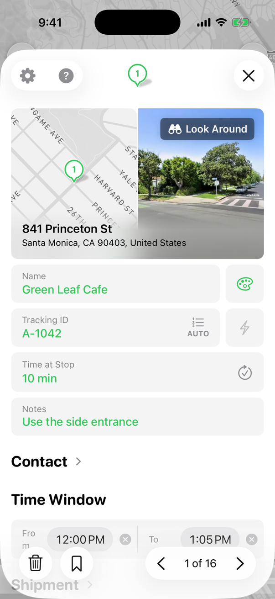
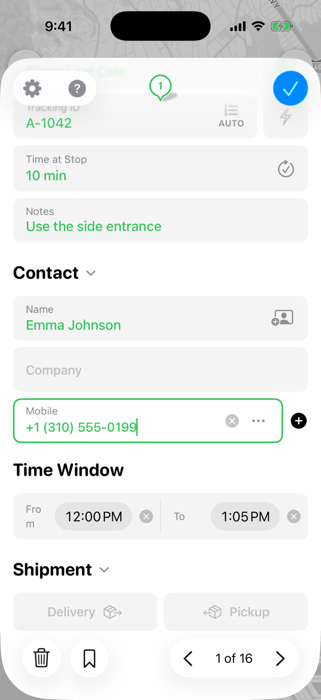
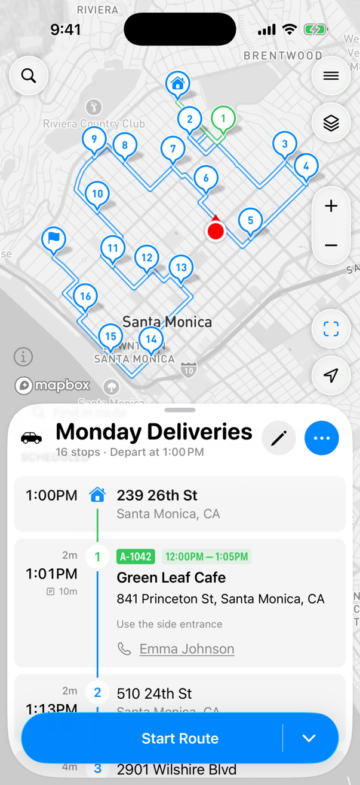

# Understanding Stop Settings


**Using MyWay on Android?** This page describes the iOS app version 3. See [Version 2 of this page](https://help.mywayroute.com/v2/guides/understanding-stop-settings).


To make sure your route matches your visit or delivery instructions and real-world situations, MyWay has a few settings for every stop. These four change how MyWay builds the route:

* [Priority](understanding-stop-settings.md#priority-asap-button)
* [Time Window](understanding-stop-settings.md#time-windows)
* [Time at Stop (Service Time, Stop Duration)](understanding-stop-settings.md#time-at-stop-service-time-stop-duration)
* [Pickup and Delivery](understanding-stop-settings.md#pickup-and-delivery)

Other settings help you tell your stops apart:

* Name
* Tracking ID
* Color
* Notes
* Contact details: name, company, phone numbers, email, website and messengers
* Premises (apartment, suite, unit, etc.)
* Package count

<figure><figcaption>
Stop's Settings - Page 1
</figcaption></figure> <figure><figcaption>
Stop's Settings - Page 2
</figcaption></figure>

The second group is for your reference and doesn't affect optimization. The **first group does affect optimization and can dramatically change the stop order**.

To open a stop's settings, tap the stop in the route. While you follow a route, tap the stop once to select it and once more to open its details.

The settings are grouped in sections: Contact, Time Window and Shipment. Tap a section title to open or collapse it. The gear button at the top left lets you choose which sections to show and in which order.

Some settings, like Tracking ID, Notes, contact details and the time window, appear on the stop card in the route. From the stop card you can call or message your customer right away (see the screenshot below).

<figure><figcaption>
Stop card in the route that shows stop settings
</figcaption></figure>

## Stop Settings

### Priority 

Priority tells MyWay how urgent a stop is. To set it, tap the lightning button next to the Tracking ID field:

* **First** and **Last** (manual ordering): the stop moves to the beginning or the end of the route right away. When you optimize, First stops stay at the beginning, Last stops stay at the end, and MyWay reorders only the stops in between.
* **High** (auto): the stop stays where it is in the list, and optimization puts it among the first stops of the route.
* **Normal**: the default. MyWay places the stop wherever it's most efficient.
* **Low** (auto): currently works the same as **Normal**, so it can't be selected in the menu.


**A tip from us:** don't set a priority for more than 2 stops. When every stop is a priority, there are no priorities at all.


### Time Windows 

Use a time window when you need to be at a stop before, after or between specific times. Set it in the Time Window section of the stop:

* **No From and no To** ("ANY"): the default. MyWay places the stop wherever it's most efficient.
* **Only From**, for example 10 AM: MyWay makes sure you arrive _after_ 10 AM. If you would get there earlier, MyWay counts the waiting time until 10 AM. The stop card shows "after 10:00 AM".
* **Only To**, for example 10 AM: MyWay makes sure you arrive _before_ 10 AM. The stop card shows "before 10:00 AM".
* **From and To**: you arrive between these times. If To is earlier than From (for example, from 10 PM to 2 AM), MyWay treats it as an overnight window.

**We don't recommend setting time windows for all stops or narrowing them down to 1–2 hours. In our experience, 3–5 hours works best.**

Time windows work a bit differently in a multi-day route. See [Planning Multi-Day routes](planning-multi-day-routes.md#time-windows).


When most of your stops have time windows, it's sometimes impossible to satisfy all of them. In this case, MyWay builds the most efficient route possible and marks the stops it can't reach in time with "Time window constraint could not be satisfied" or "Late arrival is expected at this stop", so you can handle them yourself.

Time windows are ignored if you optimize for distance or follow your route in your own (Current) order. Only **Optimize for Time** fully supports them. To learn more, see [Optimization Settings](understand-optimisation-settings.md).


### Time at Stop (Service Time, Stop Duration)

To calculate accurate ETAs, MyWay needs to know how much time you'll spend at each stop: from the moment you stop your car for the visit or delivery until you leave for the next stop.

Each stop can have its own time at stop, so set a longer or shorter one where you know a stop takes more or less time. To use the same time for every unfinished stop of the route, tap **Apply to All Stops**. New stops get the default time (5 minutes), which you can change in [Route Settings](understand-route-settings.md).

**Set the time at stop as accurately as you can. If it's off by even 1 or 2 minutes, it can greatly impact your ETAs.** See [our suggested stop durations](../faq/what-service-time-should-you-choose.md).

### Pickup and Delivery

If you pick up goods at one stop and deliver them to others, link these stops. MyWay then makes sure you never arrive at a delivery before you have picked up the goods.

1. Open the stop where you pick up the goods.
2. In the Shipment section, tap **Pickup**. You can also set the **Package Count**.
3. Tap **Deliver to…** and select the stops where you deliver the goods from this pickup.

The stops you select become deliveries automatically. The pickup stop shows "Deliver to" with the number of linked deliveries, and each delivery shows "Pick up at". One delivery can be linked to several pickups.

When you optimize the route, MyWay keeps each pickup before its deliveries. If you keep your own (Current) order and a delivery comes before its pickup, MyWay marks the stop with "Pickup must come before its delivery".

For a stop that isn't linked, you can still choose **Delivery** or **Pickup** in the Shipment section to show its type on the stop card.


**Duplicate** keeps the links between pickups and deliveries in the new route. **Copy Stops** copies the stops without these links.


### Tracking ID 

The Tracking ID is your own number for a stop, like an order or parcel number. You see it on the stop card (for example, "#12") and in reports, and you can search for it with **Find in route**.

Type the number yourself, or let MyWay number the stops:

1. Tap **AUTO** and confirm **Assign Tracking ID**. MyWay numbers all stops of the route by their position, and new stops get the next number automatically.
2. To change the numbering later, tap **AUTO** again and choose **Re-assign Tracking ID** (number the stops again by their current position) or **Disable Auto-assign**.

MyWay never replaces a number you typed yourself or imported from a file. New stops get the next free number, so after you reorder stops, tap **Re-assign Tracking ID** to number them by position again.

### Contact

In the Contact section, add the customer's name, company and ways to reach them: mobile, phone, WhatsApp, Telegram, email, Facebook, Instagram, website or other. To fill it in from your iPhone contacts, tap the contacts button next to the name. Tap **+** to add another channel and choose its type.

The contact appears on the stop card: tap it to call, send a message, or open WhatsApp, Telegram, email or the website. The Live Activity has a **Call** button too. **Find in route** also finds a contact's name, phone or email.

### Location, Look Around and Premises

The top of the stop form shows the stop on a small map and, where available, a street photo. Tap **Look Around** to see the place before you go. Tap the map to open it in full screen: there you can move the stop with **Edit Location** if the pin is in the wrong place, and add the premises (apartment, suite, unit, floor, etc.).

### Working with the stop form

* Changes are saved automatically. The arrows at the bottom ("2 of 6") take you to the previous or next stop.
* The bookmark button saves the stop to your [Saved Places](managing-your-contacts-and-places.md#stops-and-places).
* The trash button deletes the stop. If the stop is already completed, its status and proof of delivery are deleted too.
* The **?** button opens this page.

## Start and Finish Settings

The start and end locations aren't regular stops, so they don't have these settings. You can save default ones, so every new route already has them:

1. While you plan a route, tap the first button under Route Settings, below the stop list.
2. In Start & End Locations, set the default start and end locations.

When you create a new route, your default start and end locations are already set, and you don't need to add them again.
