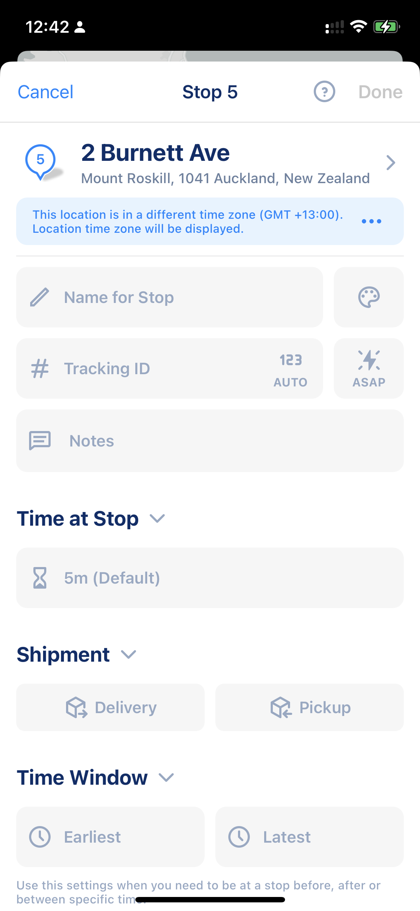
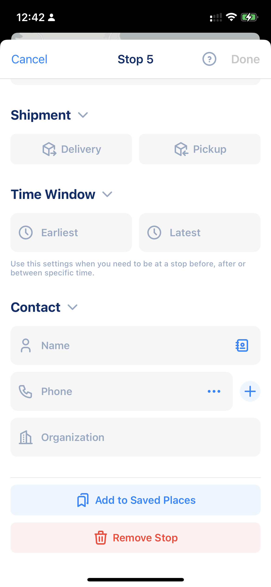
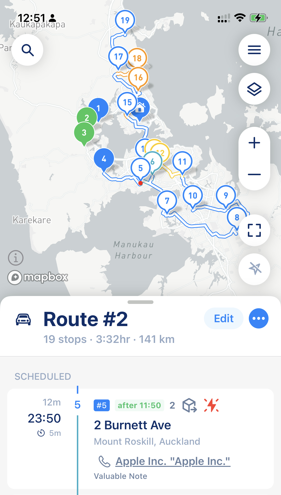

# Understanding Stop Settings


**Using MyWay on Android?** This page describes the iOS app version 3. See [Version 2 of this page](https://help.mywayroute.com/guides/understanding-stop-settings).


To make sure your route matches your visit/delivery instructions or real-world situations, MyWay has a couple of options you can set up for any stop:

* [Priority](understanding-stop-settings.md#priority-asap-button)
* [Time Window](understanding-stop-settings.md#time-windows)
* [Time at Stop (Service Time, Stop Duration)](understanding-stop-settings.md#time-at-stop-service-time-stop-duration)
* [Pickup and Delivery](understanding-stop-settings.md#pickup-and-delivery)

Also, there are some other settings that can help you to classify each stop in your list, like:

* Name
* Tracking ID
* Color
* Notes
* Contact details: name, company, phone numbers, email, website and messengers
* Premises (apartment, suite, unit, etc.)
* Package count

<figure><figcaption>
Stop's Settings - Page 1
</figcaption></figure> <figure><figcaption>
Stop's Settings - Page 2
</figcaption></figure>

While the last set of stop settings is visual and does not affect the route optimization algorithm, the **first set of settings does affect optimization algorithms and can dramatically change the stop sequence**. To open the stop settings, tap the stop you added to the route. While you follow a route, tap the stop once to select it and once more to open its details.

The stop settings are grouped in sections: Contact, Time Window and Shipment. Tap a section title to open or collapse it. The gear button at the top left lets you choose which sections to show and in which order. Use the arrows at the bottom to move to the previous or next stop; your changes are saved automatically.

Some of those stop settings, like Tracking ID, Notes, Contact details, time window, etc., are shown on the stop card in the route. You also can do some operations with them (like call your customer's phone number or send a message) directly from the stop card. See screenshot below

<figure><figcaption>
Stop card in the route that shows stop settings
</figcaption></figure>

## Stop Settings

### Priority 

Priority tells MyWay how urgent a stop is. To set it, tap the lightning button next to "Tracking ID":

* **First** and **Last** (manual ordering): the stop moves to the beginning or to the end of the route right away. Optimization keeps First stops at the beginning and Last stops at the end and reorders only the stops in between.
* **High** (auto): the stop stays where it is in the list, and optimization puts it among the first stops of the route.
* **Normal**: the default. MyWay places the stop wherever it's more efficient.
* **Low** (auto): currently works the same as **Normal**, so it can't be selected in the menu.


Please make sure you don't set a priority for more than 2 stops. When every stop is a priority, there are no priorities at all.


### Time Windows 

In the "Time Window" section, set the time when you need to arrive at the stop:

* **From and To empty** ("ANY"): the default setting. MyWay places the stop in the route wherever it's more efficient.
* **Only From**, for example 10 AM: MyWay makes sure you arrive at the stop any time _after_ 10 AM. If you arrive earlier, MyWay counts the waiting time until 10 AM. The stop card shows "after 10:00 AM".
* **Only To**, for example 10 AM: MyWay makes sure you arrive at the stop any time _before_ 10 AM. The stop card shows "before 10:00 AM".
* **From and To**: you arrive between these times. If "To" is earlier than "From" (for example, from 10 PM to 2 AM), MyWay treats it as an overnight window.

Use Time Windows when you need to be at a stop before, after, or between specific times. **It's not recommended to have time windows for all stops or have them narrowed down to 1-2 hours (the best practice is considered between 3-5 hours)**

Time Windows might behave differently when you plan a multi-day route. To understand the difference, please [check this article](planning-multi-day-routes.md#time-windows).


Please keep in mind that in some cases, when you have a time window for the majority of stops, it is simply impossible to satisfy every time window constraint. In this case, MyWay builds the most efficient route possible and marks the stops it can't reach in time with "Time window constraint could not be satisfied" or "Late arrival is expected at this stop", so you can handle them manually.

Also, time windows are going to be ignored if you choose route optimization for distance. The only mode that fully supports time windows is "Optimize for Time". Time windows will also be ignored if you decide to follow your route in your own (Current) order. To learn more about Optimisation Settings and options, check [this article](understand-optimisation-settings.md).


### Time at Stop (Service Time, Stop Duration)

To calculate accurate ETAs, MyWay needs to know how much time you'll spend at each stop. This is the amount of time between stopping your car for the visit/delivery and leaving again for the next stop.

If you know a specific stop will take more or less time, you can use this option to add the correct duration. Each stop can have its own time at stop. To use the same time for every unfinished stop of the route, tap "Apply to All Stops". The default time for new stops (5 minutes) is set in [Route Settings](how-to-use-myway-route-planner.md#route-settings). **Try setting up time at stop as accurately as possible. If it's off by even 1 or 2 minutes, it can greatly impact your ETAs.** Please check [our article on suggested stop durations](../faq/what-service-time-should-you-choose.md).

### Pickup and Delivery

If you pick up goods at one stop and deliver them to another, MyWay can link these stops, so you never arrive at a delivery before you have picked up the goods.

1. Open the stop where you pick up the goods. In the "Shipment" section, tap "Pickup". You can also set the "Package Count".
2. Tap "Deliver to…" and select the stops where you deliver the goods from this pickup.

The pickup stop shows "Deliver to" with the number of linked deliveries, and each delivery stop shows "Pick up at". A stop you select becomes a delivery automatically. One delivery can be linked to several pickups. For a stop that is not linked, you can still choose "Delivery" or "Pickup" in the "Shipment" section to show its type on the stop card.

When you optimize the route, MyWay keeps each pickup before its deliveries. If you keep your own (Current) order and a delivery comes before its pickup, MyWay marks the stop with "Pickup must come before its delivery".


"Duplicate" keeps the links between pickups and deliveries in the new route. "Copy Stops" copies the stops without these links.


## Start and Finish Settings

The Start and Finish locations are not treated as regular stops, so they don't have the same parameters. However, you can save default locations for future routes to save time.

To do this:

1. While you plan a route, tap the first button under "Route Settings", below the stop list.
2. In "Start & End Locations", set the default start and end locations.

This way, when you create a new route, your default start and end locations will already be set, and you won't need to add them again.
