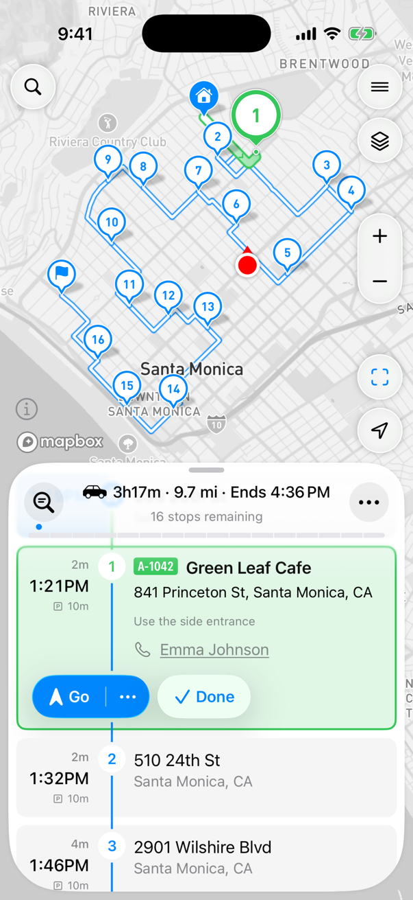
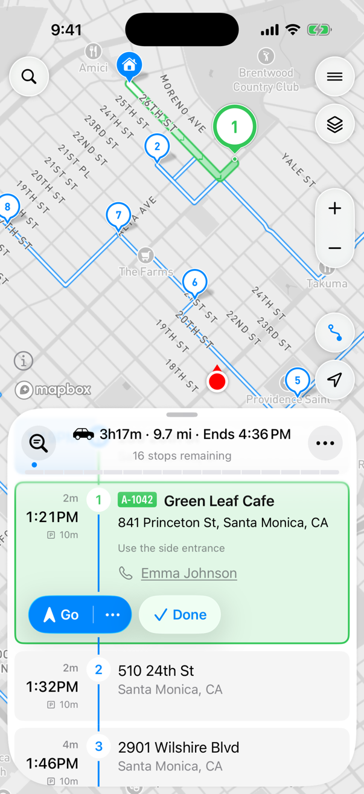
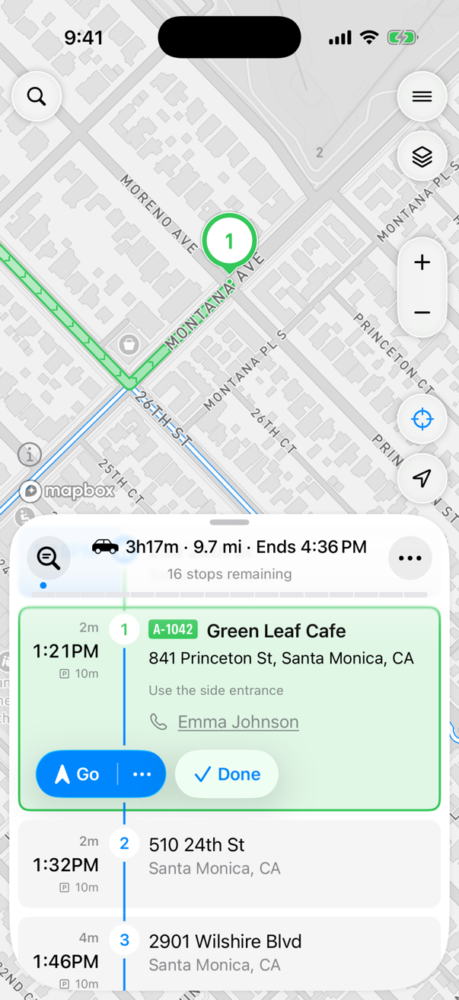

# Using the Map


**Using MyWay on Android?** This page describes the iOS app version 3. See [Version 2 of this knowledge base](https://help.mywayroute.com/v2/).


## Fitting Modes

The fitting mode adjusts the map to show the most relevant part of your route. There are three modes:

1. Whole route: the entire route on the screen.
2. Current segment: the way from your last stop to the next one.
3. Current stop: a close-up of the next stop.

To switch, tap the button above the location button on the right side of the map. While you follow a route, each tap switches to the next mode. While you plan a route, the button shows the whole route.

<figure><figcaption>
Whole route
</figcaption></figure> <figure><figcaption>
Current segment
</figcaption></figure> <figure><figcaption>
Current stop
</figcaption></figure>

To make the map follow your position, tap the location button at the bottom right of the map.

## Map Layers

Tap the layers button (top right, below the menu button) to choose what the map shows:

* **Map type**: Simple, Standard, Detailed or Satellite.
* **Traffic**: the current traffic.
* **Saved Places**: your [saved places](managing-your-contacts-and-places.md#places) as pins. Tap a pin to open the place.
* **ETA**: the estimated arrival time under each scheduled stop, the same time as in the stop list. "\~" before a time means it's approximate, "+1" means the next day. If labels overlap, MyWay hides some of them; zoom in to see more. It's off by default.
* **My Location**: your location on the map ([see below](#your-location)).

## Your Location

You can hide your current location to make it easier to work with the route. It's handy when you build and manage routes outside of your area. To hide your location, open the [map layers](#map-layers) and turn off **My Location**.

<figure><figcaption>
My Location in the map layers
</figcaption></figure>

When you follow your route and [update it](how-to-use-myway-route-planner.md#update-and-actualize-route) to actualize the ETAs with **My Location** on, MyWay takes your location as an intermediate starting point. That greatly improves ETA calculation and builds a much more accurate route. With **My Location** off, MyWay calculates from your last completed stop. Using your location can cause issues when you are in a different country or in a place that can't be reached by public roads. We recommend checking [Optimisation Settings](understand-optimisation-settings.md#starting-location) to see how your location can affect your routes.
