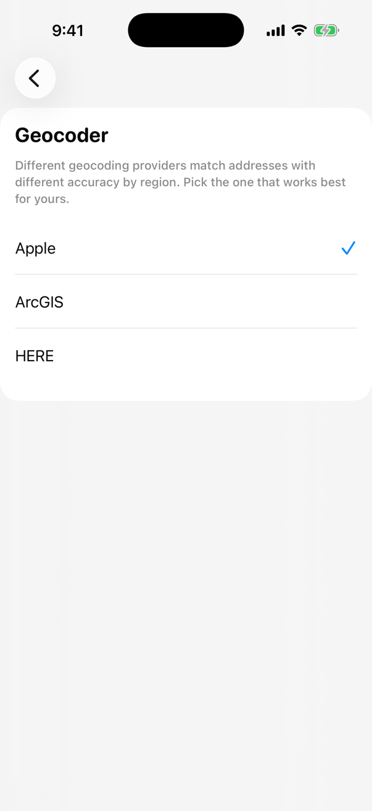

# I can't find an address


**Using MyWay on Android?** This page describes the iOS app version 3. See [Version 2 of this page](https://help.mywayroute.com/v2/i-cant-find-an-address).


MyWay combines the most up-to-date databases of addresses and places from Google Maps, Mapbox, HERE, TomTom, Apple Maps, ArcGIS and OpenStreetMap in one route planner, so we don't rely on a single provider. Still, an address may be missing from our database or be inaccurate. Let's face it: every provider out there works better in some areas and not that great in others.

### Changing Data Provider (Address Geocoding Service)

No two data providers are the same: one works best in one region, another in a different one. That's why MyWay lets you change the provider. If you often can't find addresses, try another one:

1. Open the menu (☰, top right) and tap **Preferences**.
2. Tap **Geocoder** and choose Apple, ArcGIS or HERE.

By default, MyWay picks the provider that works best for your iPhone's region.

<figure><figcaption>
Geocoding Data Provider Options
</figcaption></figure>


You can also switch the provider right on the address search screen: tap **Select Geocoder** under "Can't find address?", or **Change Geocoder** when the search has no results. The search screen shows which provider found the results ("Search data provided by…").



**Our recommendation:** for the USA, United Kingdom, Europe, Canada and Australia, use Apple or HERE; for other countries, ArcGIS or HERE.


### If the app suggests addresses in the wrong state or country 

MyWay searches for addresses around a reference point: the stops already in your route (the last added stop, the start or the end) or your current location. If location access is off, or you added a stop in another state or country earlier, that place can pull your search results there.

**How to fix it:**

* **Check location access.** Make sure MyWay is allowed to use your location.
* **Check the geocoder.** If it was changed recently, MyWay may be using a provider with less accurate results in your area.
* **Set the search area.** Add the first stop in your actual area by hand before you paste the full list.

### If the app navigates you to a wrong address

This can happen when **Navigation Precision** is set to **By Address**. MyWay can send stops to navigation apps like Google Maps, Apple Maps and Waze in two ways. [See the difference between these navigation options](guides/understand-navigation-settings.md#navigation-types-coordinates-or-address).

### How to report an incorrect address in MyWay Route Planner?

Open the menu (☰, top right) and tap **Talk to Us**. Send us the addresses and screenshots, and we will try to fix them in the address databases.

### How to report an incorrect address in Navigation Apps?

To report a wrong or missing address, we recommend doing it in **Google Maps** ([short instructions](https://support.google.com/maps/answer/6194894?co=GENIE.Platform%3DDesktop\&hl=en\&oco=1)) or in OpenStreetMap ([here](https://www.openstreetmap.org/fixthemap)).

Once Google or the OpenStreetMap community reviews and approves your report, you'll see the correct address in your navigation app and in MyWay Route Planner too.
